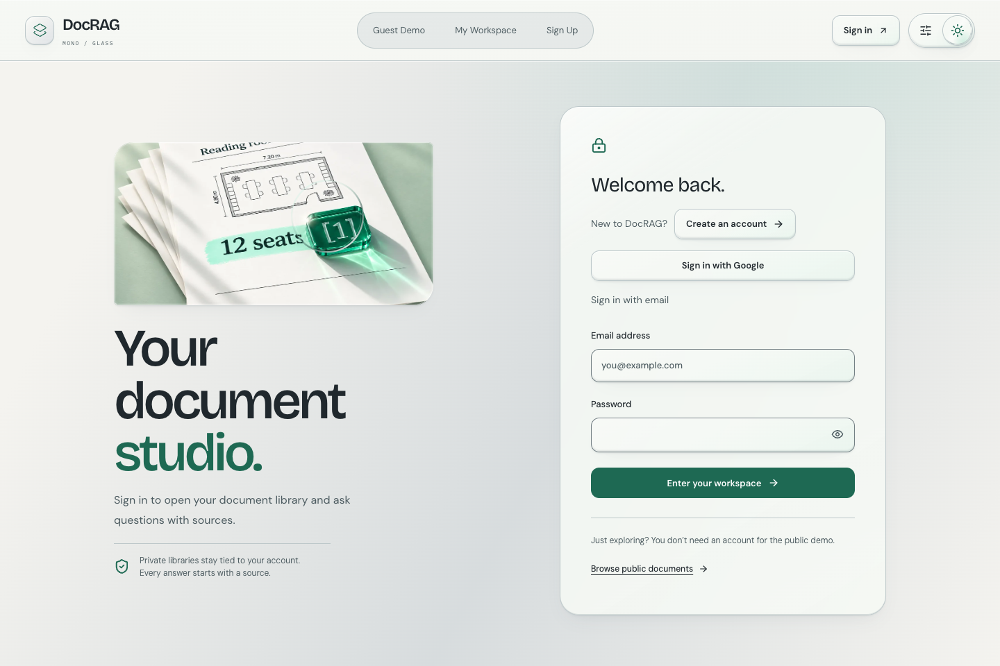

# DocRAG · Production source

DocRAG answers questions about PDFs and links each cited passage to its source page. This branch contains the Next.js application deployed on Render, the PostgreSQL retrieval pipeline, and the tools used to evaluate both. Commit `732f3fc` introduced the current account and consent behavior.

[Open DocRAG](https://docrag-demo.onrender.com/) · [Release evidence](docs/publication/WORKSPACE_RELEASE.md) · [Hosted CI](https://github.com/abhi0874/DocRAG/actions/runs/44397368846)

## How a question becomes a cited answer

1. **Index the document.** The upload handler validates the PDF, extracts text by page, and splits it at headings. Each chunk retains its page number and document ID.
2. **Retrieve evidence.** PostgreSQL runs a vector search with pgvector and a keyword search with full-text indexing. Both enforce document access before ranking. Reciprocal Rank Fusion combines up to 12 candidates from each search.
3. **Generate and validate.** The model receives the question and selected passages. DocRAG streams the answer, checks its citation references, and opens the supporting text when a reader selects a citation. It can decline a question the document cannot answer. Private and follow-up requests bypass the public response cache.

| Runtime | Answer model | Embeddings |
| --- | --- | --- |
| Hosted workspace on Render | Gemini 3.5 Flash-Lite | Gemini Embedding 001, 1,536 dimensions, isolated Neon database |
| Local workspace | `qwen3.8:latest` via Ollama 0.40.9 | `embeddinggemma:300m`, 768 dimensions, separate PostgreSQL database |

Next.js Route Handlers implement the API in TypeScript. Drizzle manages the database schema. Python runs the evaluation and operational checks. [Architecture](docs/ARCHITECTURE.md) · [Hybrid retrieval](docs/HYBRID_RETRIEVAL.md)

## Accounts and data boundaries

Better Auth provides email/password and Google sign-in with eight-hour database-backed sessions. Registration stores the accepted terms version, country, and timestamp. Returning users retain that record across sessions and navigation. Turning hosted AI off blocks hosted processing while preserving the original acceptance. Profile lets users change their display name and picture or delete their account.



Hosted users may submit only non-sensitive material they have permission to share. Questions and document excerpts go to Google’s unpaid Gemini service. Private PDFs, downloads, citations, and feedback are scoped to their owner. Account deletion revokes sessions and removes the user’s private application records. [Security model](docs/SECURITY_MODEL.md) · [Security checks](docs/SECURITY.md)

## Run locally

Use Node **24.22.1**, pnpm **11.25.0**, Python **3.14.6**, and an isolated PostgreSQL database with pgvector. From a new checkout:

```sh
git clone --branch feat/production-rag https://github.com/abhi0874/DocRAG.git
cd DocRAG
make setup
cp .env.example .env
```

Configure the provider, database, auth secret, and app origin in the private environment file. For Ollama, verify the pinned model digests and prepare the matching index before running `make run-api`. The development server listens on port 8000. [Command contract](docs/COMMAND_CONTRACT.md) · [Local Ollama](docs/LOCAL_OLLAMA.md) · [Docker setup](docs/DOCKER.md)

## Verification

| Scope | Recorded result |
| --- | --- |
| Release unit tests | 231 Python and 565 TypeScript tests passed. Use `make test` to run both suites. |
| Live Render acceptance | 29 checks passed, covering consent persistence, profile updates, a real Gemini stream with a page-one citation, two-account isolation, and deletion. |
| Historical local Ollama evaluation | Recall@5 **97.5%**, automated correctness **99.0%**, and **265/265** supported citations on 100 frozen questions. |

The local evaluation generated 100 fresh answers and reused 85 of 100 judge results. It measures the local configuration on two public documentation sources. Render acceptance verified behavior on a synthetic PDF. The two results answer different questions. [Evaluation methodology](docs/AUTOMATED_EVALUATION.md) · [Benchmark provenance](docs/ui-redesign/VERIFICATION.md)

Render runs a non-root image pinned by digest. The [release record](docs/publication/WORKSPACE_RELEASE.md) identifies the deployed artifact, the time-limited security decision, and the rollback image. For further work, see [testing](docs/TESTING.md), [observability](docs/OBSERVABILITY.md), and [load testing](docs/LOAD_TESTING.md).
