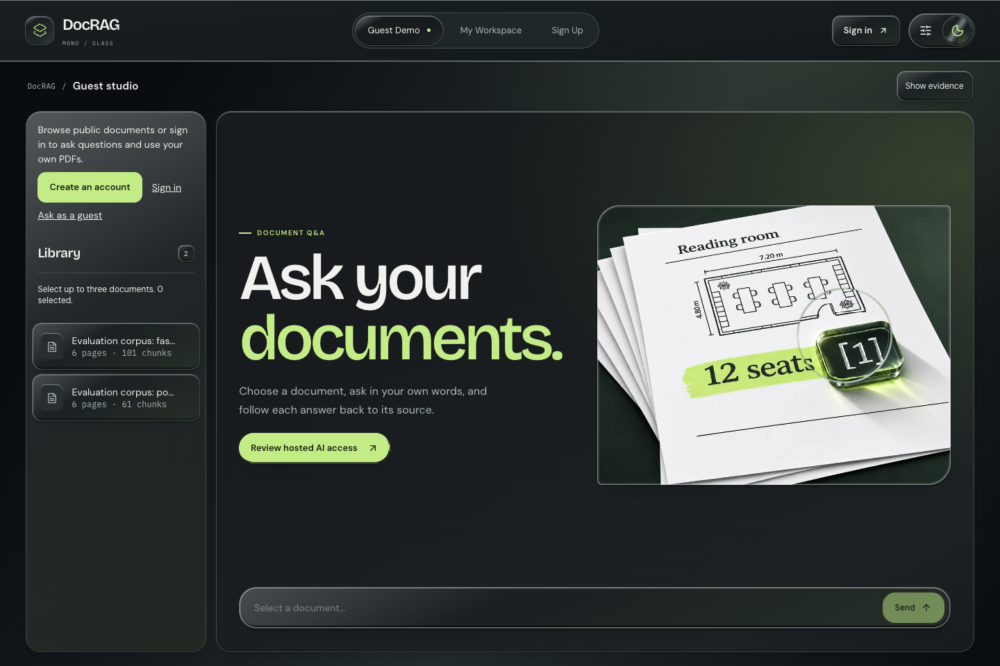

# DocRAG

Upload a PDF, ask a question in your own words, and open a citation to see the passage behind the answer. DocRAG runs in your browser. The hosted workspace supplies the Gemini API key.

[**Open the live demo**](https://docrag-demo.onrender.com/) · [Create an account](https://docrag-demo.onrender.com/sign-up) · [Production source and setup](https://github.com/abhi0874/DocRAG/tree/feat/production-rag)

## Try it with a document

1. **Sign up.** Choose your country and review the hosted AI terms. If eligible, continue with Google or email and password. DocRAG remembers your acceptance when you return.
2. **Upload a short, non-confidential PDF.** Open **My Workspace**, wait for indexing, and select your document. To explore first, **Guest Demo** lets you browse two public documentation sets.
3. **Ask something you can check.** For example, upload a public event programme and ask “When does the first workshop start?” Open the numbered citation to compare the answer with the original page. A follow-up can refer to the same workshop. If the programme omits a detail, DocRAG can tell you the evidence is insufficient.

## Your account and documents

Profile lets you change your name or picture, read your original terms and country, and delete your account. You can turn hosted AI off separately. Switching between Guest Demo and My Workspace retains your account’s acceptance.

The free hosted service is for eligible adults using it professionally. Use only material you can share with Google’s unpaid Gemini service. Each account can keep three PDFs of up to 2 MB each and upload twice per day. PDFs expire after 30 days and are removed on the next active library or chat request. You can delete them sooner. Shared quotas and occasional cold starts apply.

## Behind the demo

The live release passed 29 production checks, including a real streamed Gemini answer with a verified page citation and a check that a second account could not read the first account’s upload. This default branch contains the original implementation. The deployed application, local setup, and evaluation results are maintained on the production branch. [Release evidence](https://github.com/abhi0874/DocRAG/blob/feat/production-rag/docs/publication/WORKSPACE_RELEASE.md) · [Engineering README](https://github.com/abhi0874/DocRAG/tree/feat/production-rag#readme)
