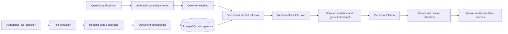
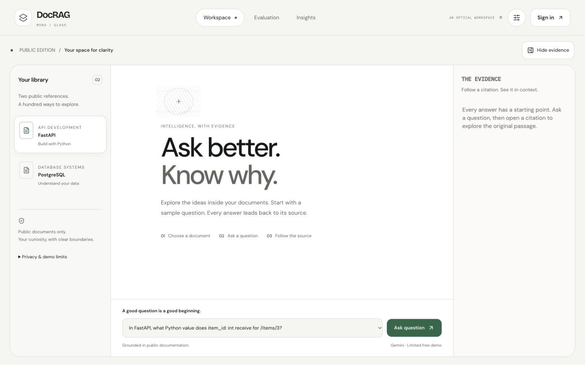
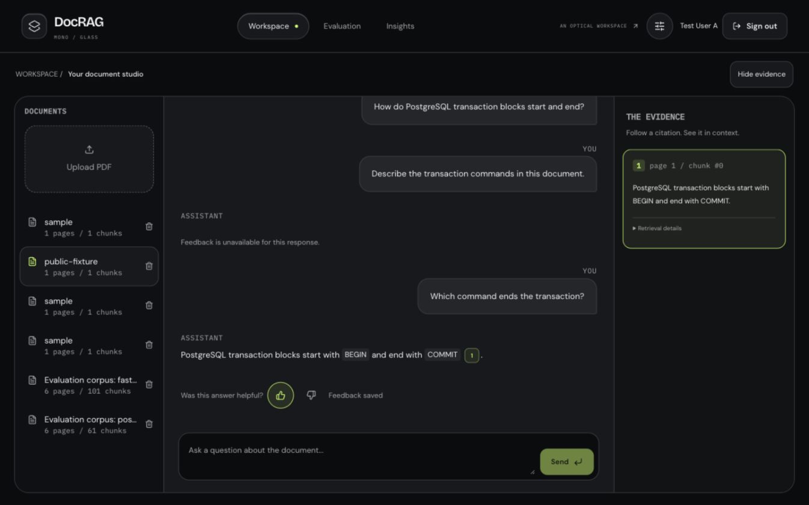

# DocRAG — Intelligent Document Q&A System

**Hybrid retrieval. Streamed answers. Verifiable sources.**

DocRAG is a production-deployed Retrieval-Augmented Generation application combining
semantic and keyword retrieval, secure document management, streamed AI responses,
and inspectable source citations. The MONO / GLASS interface connects a document
library, conversation, and evidence pane in one responsive workspace.

[**Live demo**](https://docrag-demo.onrender.com/) ·
[Architecture](docs/ARCHITECTURE.md) · [Evaluation](docs/AUTOMATED_EVALUATION.md) ·
[Production release](docs/publication/WORKSPACE_RELEASE.md) · [Security](docs/SECURITY.md)

[](https://github.com/abhi0874/DocRAG/actions/workflows/ci.yml?query=branch%3Afeat%2Fproduction-rag)


## Try the application

1. [Create an account](https://docrag-demo.onrender.com/sign-up) and review the hosted AI consent disclosure. Returning users can [sign in](https://docrag-demo.onrender.com/sign-in).
2. Upload a short, non-confidential text PDF (up to 2 MB). Select it after indexing completes.
3. Ask your own document-related question and a follow-up. Select a numbered citation to see the page and supporting passage. When the document lacks the answer, the workspace says so.
4. Delete your PDF from the library and sign out. The Gemini API key is provided by the server.

Hosted processing is for eligible adults using the demo professionally in the countries and territories listed by the deployed sign-up form. Keep personal, sensitive or confidential material out of documents and questions. Shared free quotas apply. Accounts can hold three PDFs and upload twice per day. Uploads have a 30-day expiry.

**Production release** — `c1a228d` is live on Render Free. The light and dark themes use sage and jade document artwork. Email registration and sign-in are enabled. Google sign-in requires production OAuth credentials and is currently unavailable. [Live acceptance and image identity](docs/publication/WORKSPACE_RELEASE.md)

## The problem

Document search should return an answer with evidence readers can check. DocRAG
retrieves relevant passages, asks the model to answer within that evidence, validates
citation references, and makes their source text accessible beside the conversation.
Authentication and ownership checks apply throughout retrieval and document access.

## Features and operating modes

| Capability | Public Gemini demo | Authenticated local workspace |
| --- | --- | --- |
| Questions | Free-form questions and follow-ups on public sources or your own PDFs | Questions and follow-ups over authorized documents |
| Document ingestion | Private PDF upload, extraction, indexing and owner deletion | PDF validation, extraction, chunking and owned storage |
| Retrieval | Semantic + PostgreSQL full-text search with RRF | Same hybrid pipeline with document ACLs |
| Answers | Gemini streaming, grounded citations, refusal and cancellation | Local Ollama streaming with the same validation stages |
| Accounts and activity | Self-registration, consent and scoped document access | Eight-hour sessions, private libraries, owned evaluations and feedback |
| Interface | MONO / GLASS library/chat/evidence, themes and appearance | Same components plus upload, conversation and evaluation tools |

Server-side origin checks, database quotas, cancellation accounting, request IDs
and source validation apply to both profiles. The reranker and public response
cache default OFF. Private and multi-turn responses bypass the public cache.

## Architecture



- **Frontend and API** — Next.js 16.4.5, React 19.2.4, TypeScript and Tailwind CSS.
  Route Handlers implement API/auth/streaming endpoints.
- **Storage** — Drizzle ORM over PostgreSQL/pgvector stores documents, vectors,
  original private PDFs, sessions, atomic quotas, answer receipts and feedback.
- **Security** — Better Auth database sessions and SQL ownership predicates protect
  vector and keyword retrieval, citation reads, private files and user activity.
- **Providers** — The shared answer pipeline selects Gemini or local Ollama. Python
  handles evaluation and operational verification; the web backend is TypeScript.
- **Hosting** — A non-root Docker runtime on Render Free connects to the restricted
  Neon demo role. HTTPS, verified database TLS and the exact app origin are required.

### Ingestion and retrieval

PDFs pass size/structure checks before text extraction. Heading-aware chunks use
size 1,400 with overlap 280 and retain source/page metadata. Embeddings are stored
transactionally with their owning document. Hybrid retrieval runs 12 vector and
12 keyword candidates in parallel and combines them with **RRF k=60**. Selected
excerpts feed the grounded prompt; citations map back to the authorized evidence.
The optional MiniLM reranker has bounded timeout and fallback behavior.

### Model and embedding separation

| Profile | Answer model | Embeddings | Storage |
| --- | --- | --- | --- |
| Local benchmark/workspace | `qwen3.8:latest`, preserved Ollama 0.40.9 | `embeddinggemma:300m`, 768 dimensions | Isolated local database |
| Hosted public demo | Reviewed `gemini-3.5-flash-lite` | `gemini-embedding-001`, 1,536 dimensions | Dedicated `docrag_demo_gemini_v1` |

The local benchmark checks exact model digests and fixed generation settings.
The hosted index has a distinct embedding-space version and verified public corpus.
Dimensions, credentials and historical vectors are never mixed. Local digests and
settings are recorded in [local model configuration](lib/local-model-config.json).

## MONO / GLASS

Obsidian Lime pairs charcoal surfaces with electric lime; Pearl Forest uses warm
light surfaces and forest green. Bricolage Grotesque, DM Sans and IBM Plex Mono
provide display, reading and technical typography.

The reusable liquid selector morphs one SVG contour through an elapsed-time damped
spring, velocity-based stretch and surface-tension-inspired recovery. Selection
works immediately through radio semantics, keyboard controls and visible focus.
Glass intensity ranges from 0–100, with Low/Balanced/High presets and saved settings.
Bounded displacement bends public decorative artwork; text and hit targets stay
clear. Reduced motion and simpler materials remain available.

<details>
<summary>Light theme, source citations, and appearance controls</summary>





The cited-answer capture uses synthetic public transaction text in the local QA
workspace and includes an earlier cancelled response. It demonstrates source focus.


</details>

Measured short browser interactions observed approximately 120Hz, frame p95
8.6–9.3ms and 11 estimated drops over 13,173 frames. 165Hz hardware was unavailable.
[Design](docs/ui-redesign/DESIGN.md) · [Acceptance](docs/ui-redesign/ACCEPTANCE.md) ·
[Performance and browser limits](docs/ui-redesign/PERFORMANCE.md)

## Verified results

| Metric | Result | Scope |
| --- | ---: | --- |
| Recall@5 | **97.5%** | Local Ollama retrieval |
| Automated answer correctness | **99.0%** | Local automated judge score |
| Automated faithfulness | **100%** | Local automated judge score |
| Citation validation | **265/265** | Local evaluated occurrences |
| Automated tests | **491 passed** | 218 Python + 273 TypeScript |
| Production smoke checks | **55/55** | Historical release `6458b35` |

The frozen 100-question benchmark contains 80 answerable and 20 refusal questions
from two public documentation sources. Final run `ui-redesign-d` generated 100 fresh
answers and query embeddings with 15 fresh and 85 cached judgments. Qwen is both
answer model and judge, so these scores have limited independence and corpus scope.
They are not hosted Gemini answer-accuracy measurements. Recall and faithfulness
regression declines greater than .02 fail the existing gates, including negative
controls for degraded results and incompatible provenance.

For the historical UI release `6458b35`, the full local contract passed 27/27 groups before the final UI-only cancellation
request repair. Fourteen applicable checks passed afterward. Hosted CI passed on
that historical application commit. Its production smoke used three admitted Gemini requests
to check secure sessions, two-user isolation, public access, streaming/citations,
refusal, cancellation, quotas and client-secret exposure.

TS statement coverage for that run was 58.31%; Python unit-only scripts coverage was 20.17%.
The earlier complete Python integration result is historical 76.46%, with its original
mixed-run provenance retained. The unchanged integration gate remains 70%.
[Full results and limitations](docs/ui-redesign/VERIFICATION.md) ·
[Production smoke receipt](docs/publication/mono-glass-production-smoke.json) ·
[Hosted release CI](https://github.com/abhi0874/DocRAG/actions/runs/43883857434)

## Security and privacy

- Server-side document ACLs cover both retrieval branches, direct reads and sources.
- Better Auth uses fixed eight-hour sessions, HttpOnly/Secure/SameSite cookies,
  database validation, rate-limited hosted registration and exact trusted origins.
- Input/PDF validation, atomic database rate limits and bounded concurrency constrain
  uploads and inference. Cancellation propagates and prevents partial cache writes.
- Private/history responses bypass public caching. Feedback references server-owned
  receipts; private content cannot enter the public feedback export.
- The hosted workspace accepts non-confidential PDFs after consent. Questions and
  excerpts go to unpaid Gemini. Google may review them and use them for product improvement.
- Secrets remain server-side in ignored local files or hosting secret settings.
  Restrict database users and require verified TLS for Neon connections.

[Security model](docs/SECURITY_MODEL.md) · [Security verification](docs/SECURITY.md) ·
[Observability](docs/OBSERVABILITY.md)

## Local development

Use **Node 24.22.1**, **pnpm 11.25.0**, **Python 3.14.6**, and PostgreSQL with
pgvector. The exact Node pin preserves the Web Streams cancellation regression fix.

```sh
git clone --branch feat/production-rag https://github.com/abhi0874/DocRAG.git
cd DocRAG
make setup
cp .env.example .env
```

Configure `.env` privately before starting the server. Select a free, isolated
PostgreSQL port and database. The existing Mac checkout uses 55433; example defaults
use 55432 and must be adjusted if occupied. `scripts.native_db` expects Postgres.app
PostgreSQL 16 at its documented macOS location. Other platforms can use the reviewed
Docker path. Preserve initialized data and ownership markers on existing checkouts.

| Settings | Purpose |
| --- | --- |
| `AI_PROVIDER`, provider key, `DATABASE_URL` or `OLLAMA_DATABASE_URL` | Explicit provider and matching isolated embedding database |
| `BETTER_AUTH_SECRET` | Privately generated session secret, at least 32 characters |
| `DOCRAG_APP_ORIGIN`, `DOCRAG_LOCAL_HTTP` | Exact app origin; explicit loopback HTTP exception for development |
| `DOCRAG_POSTGRES_PORT` | Native owned cluster port matching connection settings |
| `RERANKER_ENABLED`, `RESPONSE_CACHE_ENABLED` | Leave false for the default configuration |

For local Ollama, preserve runtime 0.40.9 and both model digests. Follow the
[local provider guide](docs/LOCAL_OLLAMA.md) and current
[command contract](docs/COMMAND_CONTRACT.md) to prepare its isolated index and an
operator-created account. Hosted Gemini uses the separate `GEMINI_API_KEY`,
`DEMO_DATABASE_URL` and deployment settings documented in [deployment](docs/DEPLOYMENT.md).

After the selected database/provider/account is configured:

```sh
make db-status
make run-api
# Open http://127.0.0.1:8000 with a matching private origin setting.
```

`make up` initializes/applies development SQL and is reserved for a reviewed local
setup. Inspect existing service ownership before running it.

### Docker

The existing multi-stage Dockerfile pins Node by image digest and runs as a
non-root user. Compose uses a dedicated internal database and binds the app to
loopback port 8010. Follow [Docker instructions](docs/DOCKER.md) to create private
credentials and check the host model endpoint before starting this isolated stack.

```sh
docker compose --env-file .local/step9-compose.env config --quiet
docker compose --env-file .local/step9-compose.env build
docker compose --env-file .local/step9-compose.env up -d
```

## Testing and evaluation

The ordinary local checks require no paid model calls:

```sh
make lint
make test
make cov
make build-fe
```

The full evaluation requires the preserved local models and verified native corpus:

```sh
AI_PROVIDER=ollama make eval
make local-validate-results
AI_PROVIDER=ollama make eval-gate
```

Full HTTP/database/security verification has a longer ordered sequence and uses
fresh run IDs. Read the [command contract](docs/COMMAND_CONTRACT.md) before invoking
setup, migrations, lifecycle tests or inference. Preserve golden labels, model
settings, historical results and cache provenance.
[Testing strategy](docs/TESTING.md) · [Automated evaluation](docs/AUTOMATED_EVALUATION.md) ·
[Hybrid retrieval](docs/HYBRID_RETRIEVAL.md) · [Load testing](docs/LOAD_TESTING.md)

## CI/CD and deployment

GitHub Actions runs pinned tooling, lint/types, unit tests, coverage, a production
build, real SQL migrations/retrieval and citation/quality negative controls.
Render uses the verified non-root AMD64 image pinned by digest. Git auto-deploy is disabled. Neon stores the public index and owner-scoped workspace data. Gemini generation uses the server-side key in a project with billing disabled.
The public profile caps generation at two requests/minute per user, four globally
per minute and 50 per application day window, with bounded output/context,
45-second timeout and zero generation retries. Credentials and quota settings are
configured privately. Deployments require applicable authorization and live smoke
verification. [Deployment operations](docs/DEPLOYMENT.md)

## Known limitations

- Free cold starts, shared quotas and provider allowances constrain availability.
  Paid usage was ₹0 at release verification; this is an observed result.
- The workspace runs under time-limited security decisions expiring 25 November 2026 at 13:30 IST. [Scope and withdrawal criteria](docs/publication/WORKSPACE_RELEASE.md)
- Two reviewed moderate JS tooling advisories remain for esbuild and minimatch.
  The dependency policy records their raw audit findings. [Assessment](docs/SECURITY.md)
- Evaluation uses a small documentation corpus and an automated judge. The hosted
  Gemini retrieval experiment is separate from local answer-quality scores.
- High-refresh observations come from short desktop fixtures. 165Hz hardware,
  Firefox and physical mobile/keyboard testing remain unverified.
- Vercel's legacy deployment has incomplete demo/auth configuration and a managed
  Node patch policy. Render remains the verified public deployment.

## Engineering documentation

[Architecture](docs/ARCHITECTURE.md) · [Technical handoff](docs/PROJECT_HANDOFF.md) ·
[Chunking](docs/CHUNKING_EXPERIMENTS.md) · [Retrieval](docs/HYBRID_RETRIEVAL.md) ·
[Local models](docs/LOCAL_OLLAMA.md) · [Security](docs/SECURITY.md) ·
[Observability](docs/OBSERVABILITY.md) · [CI](docs/CI.md) ·
[Production release](docs/publication/WORKSPACE_RELEASE.md) ·
[UI design](docs/ui-redesign/DESIGN.md)
