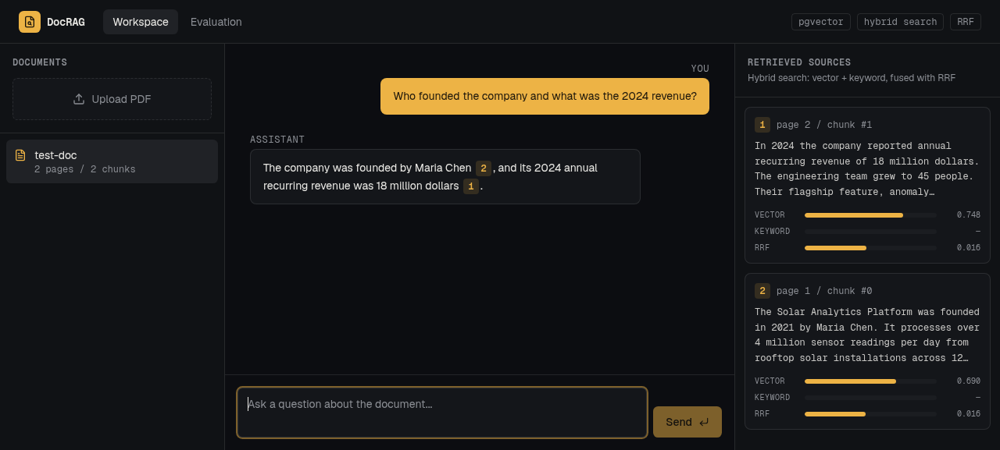
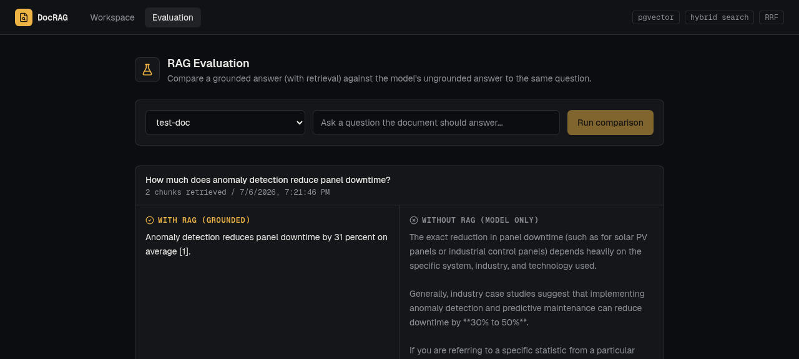

# DocRAG — RAG Document Assistant

Chat with your PDFs using Retrieval-Augmented Generation. Upload a document, ask questions, and get streaming answers grounded in the source text — with inline citations, inspectable retrieval scores, and a built-in evaluation page that proves why RAG beats a bare LLM.

**Stack:** Next.js (App Router) · Vercel AI SDK · Google Gemini (`gemini-3.5-flash` + `gemini-embedding-2`) · Neon Postgres with `pgvector` · Tailwind CSS

Runs entirely on free tiers: Google AI Studio (no credit card) + Neon free tier.

## Screenshots

**Grounded chat with inline citations and inspectable retrieval scores:**



**RAG vs no-RAG evaluation — the same question, side by side:**



## Features

- **PDF ingestion pipeline** — parse, chunk with overlap, embed, and store in Postgres
- **Hybrid retrieval** — vector similarity search + Postgres full-text keyword search, fused with Reciprocal Rank Fusion (RRF)
- **Grounded streaming chat** — answers cite the exact chunks they came from, with clickable `[1]`-style citation chips and page numbers
- **Sources panel** — every retrieved chunk is shown with its vector score, keyword rank, and final RRF score
- **Evaluation page** — ask the same question with and without retrieval, side by side, and persist the comparison

## Architecture

```
                        ┌──────────────────────────────────────────┐
  PDF upload ──────────▶│  /api/documents                          │
                        │  1. Extract text per page (unpdf)        │
                        │  2. Chunk (~1000 chars, 200 overlap)     │
                        │  3. Embed batch (gemini-embedding-2)     │
                        │  4. INSERT chunks + vectors into Neon    │
                        └──────────────────────────────────────────┘

                        ┌──────────────────────────────────────────┐
  Question ────────────▶│  /api/chat                               │
                        │  1. Embed the query                      │
                        │  2. Hybrid search:                       │
                        │     • pgvector cosine (HNSW index)       │
                        │     • tsvector keyword (GIN index)       │
                        │     • fuse with RRF                      │
                        │  3. Build grounded prompt from top-k     │
                        │  4. streamText (gemini-3.5-flash)        │
                        │  5. Stream answer + sources to the UI    │
                        └──────────────────────────────────────────┘
```

### Database schema

| Table         | Purpose                                                                                      |
| ------------- | -------------------------------------------------------------------------------------------- |
| `documents`   | Uploaded PDF metadata (title, page count, chunk count, status)                                |
| `chunks`      | Text chunks with `vector(1536)` embeddings, a generated `tsvector` column, HNSW + GIN indexes |
| `evaluations` | Saved RAG vs no-RAG comparisons with the retrieved chunks as JSONB                            |

## Key Design Decisions

### Chunking: ~1000 characters with 200-character overlap

Small chunks retrieve precisely but lose context; large chunks preserve context but dilute relevance and waste prompt tokens. ~1000 characters is a good middle ground for prose documents. The 200-character overlap ensures a sentence that straddles a chunk boundary is fully present in at least one chunk, so retrieval never returns a "cut-off" thought.

### Hybrid search instead of vector-only

Vector search excels at semantic matches ("revenue" ≈ "annual earnings") but can miss exact terms — IDs, names, acronyms, numbers. Keyword search (Postgres `tsvector`) is the opposite. Combining both covers each other's blind spots.

The two ranked lists are fused with **Reciprocal Rank Fusion**:

```
score(chunk) = Σ 1 / (60 + rank_i)
```

RRF only uses rank positions, so it needs no score normalization between the two systems — simple, robust, and hard to beat.

### Citations as a first-class feature

The model is instructed to answer **only** from the retrieved chunks and to cite them as `[1]`, `[2]`, etc. The UI renders these as chips linking to the sources panel, where the full chunk text, page number, and retrieval scores are visible. If the answer is not in the document, the model says so instead of guessing — the primary defense against hallucination.

### Evaluation built in, not bolted on

The `/evaluate` page runs the same question through two paths — grounded RAG and the bare model — and stores both answers. Example result from testing:

> **Q:** How much does anomaly detection reduce panel downtime?
>
> **RAG:** "31 percent [1]" — exact, cited from the document
>
> **No RAG:** "typically 30% to 50%" — plausible-sounding guess

This is the whole argument for RAG in one screenshot.

## Getting Started

### Prerequisites

- Node.js 20+ and pnpm
- A [Neon](https://neon.tech) Postgres database (free tier)
- A free Google AI Studio API key — [aistudio.google.com/apikey](https://aistudio.google.com/apikey) (no credit card required)

### Setup

1. **Install dependencies**

   ```bash
   pnpm install
   ```

2. **Environment variables** — create `.env.local`:

   ```bash
   DATABASE_URL=postgres://...          # Neon connection string
   GOOGLE_GENERATIVE_AI_API_KEY=AIza... # free Gemini key
   ```

3. **Database schema** — run once against your Neon database:

   ```sql
   CREATE EXTENSION IF NOT EXISTS vector;

   CREATE TABLE documents (
     id serial PRIMARY KEY,
     title text NOT NULL,
     filename text NOT NULL,
     page_count integer NOT NULL DEFAULT 0,
     chunk_count integer NOT NULL DEFAULT 0,
     status text NOT NULL DEFAULT 'processing',
     created_at timestamptz NOT NULL DEFAULT now()
   );

   CREATE TABLE chunks (
     id serial PRIMARY KEY,
     document_id integer NOT NULL,
     chunk_index integer NOT NULL,
     page_number integer NOT NULL DEFAULT 1,
     content text NOT NULL,
     embedding vector(1536),
     content_tsv tsvector GENERATED ALWAYS AS (to_tsvector('english', content)) STORED,
     created_at timestamptz NOT NULL DEFAULT now()
   );

   CREATE INDEX chunks_embedding_idx ON chunks USING hnsw (embedding vector_cosine_ops);
   CREATE INDEX chunks_tsv_idx ON chunks USING gin (content_tsv);

   CREATE TABLE evaluations (
     id serial PRIMARY KEY,
     document_id integer NOT NULL,
     question text NOT NULL,
     rag_answer text NOT NULL,
     no_rag_answer text NOT NULL,
     retrieved_chunks jsonb NOT NULL DEFAULT '[]',
     created_at timestamptz NOT NULL DEFAULT now()
   );
   ```

4. **Run**

   ```bash
   pnpm dev
   ```

   Open [http://localhost:3000](http://localhost:3000), upload a PDF, and start asking questions.

## Project Structure

```
app/
  page.tsx                      # Workspace: documents + chat + sources
  evaluate/page.tsx             # RAG vs no-RAG evaluation
  api/
    documents/route.ts          # Upload + ingestion pipeline, list documents
    documents/[id]/route.ts     # Delete a document and its chunks
    chat/route.ts               # Hybrid retrieval + grounded streaming chat
    evaluations/route.ts        # Run and persist RAG vs no-RAG comparisons
components/
  workspace.tsx                 # Three-panel layout and shared state
  document-panel.tsx            # Upload, list, delete documents
  chat-panel.tsx                # Streaming chat with citation chips
  sources-panel.tsx             # Retrieved chunks with relevance scores
  evaluation-panel.tsx          # Side-by-side comparison UI
lib/
  rag.ts                        # Chunking, embedding, hybrid search, RRF
  db/                           # Drizzle client + schema
  types.ts                      # Shared types
```

## What I'd Improve Next

- **Retrieval quality:** add a cross-encoder re-ranking step over the RRF top-k
- **Evaluation rigor:** automated eval sets with LLM-as-judge scoring (faithfulness, answer relevance) instead of manual comparison
- **Scale:** move ingestion to a background job queue for large PDFs; currently it runs in the request
- **Multi-document chat:** query across all documents at once with per-document source attribution
- **Auth:** per-user document libraries (schema already supports adding a `user_id` scope)

## Built with v0

This repository is linked to a [v0](https://v0.app) project. Changes made in v0 are pushed to this repo automatically.

[Continue working on v0 →](https://v0.app/chat/projects/prj_qTZd6VpyLFuv4KDry7z52wqlDThX)

## License

MIT
