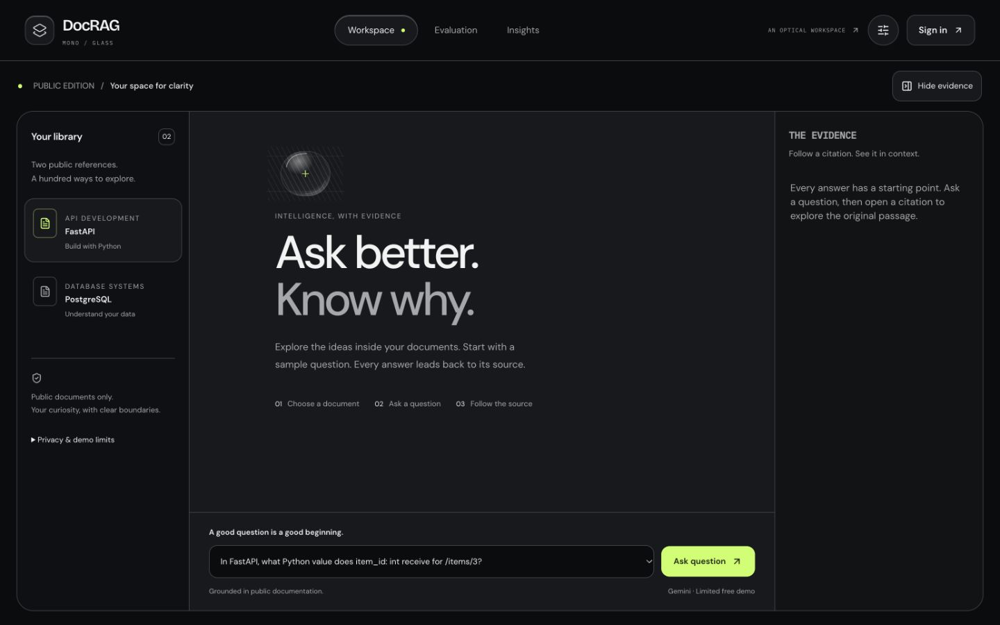
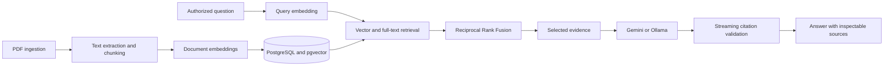
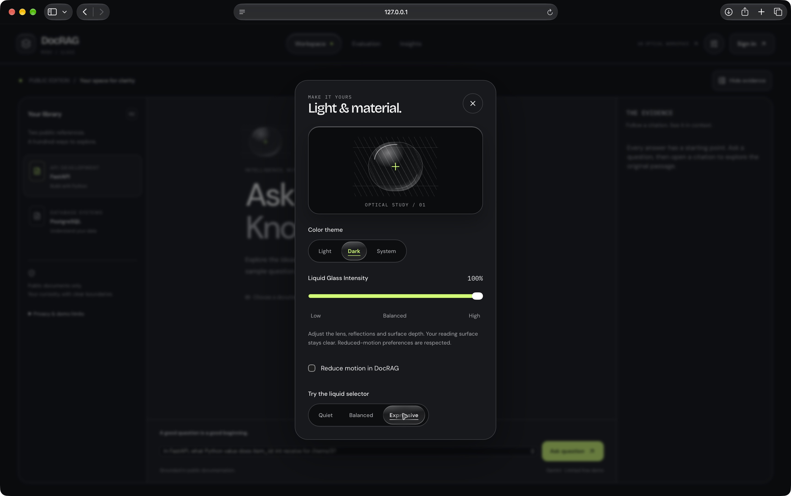

# DocRAG — Intelligent Document Q&A System

**Hybrid retrieval. Streamed answers. Verifiable sources.**

A production-deployed Retrieval-Augmented Generation application combining semantic
and keyword search, secure document management, streamed AI responses, and source
citations you can inspect in context.

[**Try the live demo**](https://docrag-demo.onrender.com/) ·
[**Production source**](https://github.com/abhi0874/DocRAG/tree/feat/production-rag) ·
[Architecture](https://github.com/abhi0874/DocRAG/blob/feat/production-rag/docs/ARCHITECTURE.md) ·
[Evaluation](https://github.com/abhi0874/DocRAG/blob/feat/production-rag/docs/AUTOMATED_EVALUATION.md)

[](https://github.com/abhi0874/DocRAG/actions/workflows/ci.yml?query=branch%3Afeat%2Fproduction-rag)




> **Source guide** — `main` contains the earlier application implementation and
> this project showcase. The deployed MONO / GLASS application, current setup
> instructions, tests, and engineering documentation live in
> [`feat/production-rag`](https://github.com/abhi0874/DocRAG/tree/feat/production-rag).

## Try it in a minute

1. Open the [Render demo](https://docrag-demo.onrender.com/).
2. Choose FastAPI or PostgreSQL and a public sample question.
3. Watch the answer stream, then select a citation to read its supporting passage.
4. Open Appearance to try both themes, glass intensity, and liquid pill controls.

Anonymous visitors can use the public questions without an account or API key.
The Free service can take about a minute to wake, and shared request limits apply.
The public edition accepts only reviewed public questions. Private PDF uploads
and arbitrary conversations belong to the authenticated local application.

## Why DocRAG

Finding an answer inside a document is only half the problem. Readers also need
to know where it came from. DocRAG combines ranked evidence with grounded generation
and attaches validated citations to the answer, while keeping each user's documents,
sessions, feedback, and metrics under server-side access controls.

## Built capabilities

| Area | Implementation |
| --- | --- |
| Document Q&A | PDF extraction, heading-aware chunking, embeddings, grounded answers and source inspection |
| Hybrid RAG | Parallel semantic and PostgreSQL full-text retrieval, combined with Reciprocal Rank Fusion (RRF) |
| Answer delivery | Streamed responses, cancellation propagation, citation validation and explicit refusals |
| Private workspace | Authenticated uploads, document ownership checks, eight-hour sessions and isolated user activity |
| Providers | Gemini for the hosted public demo; preserved local Ollama models for private workflows and evaluation |
| Operations | Database-backed quotas, request IDs, stage timings, cancellation accounting and owned feedback |
| MONO / GLASS | Responsive library/chat/evidence layout, Obsidian Lime and Pearl Forest themes, spring-driven liquid pills and persistent glass intensity |

## Architecture



Next.js Route Handlers run the backend. Better Auth validates sessions; SQL access
predicates apply to retrieval, document reads, and citations. Separate embedding
spaces keep local Ollama vectors isolated from hosted Gemini vectors. Python supplies
evaluation and operational tooling. Render runs the pinned Docker application and
Neon stores the isolated public demo index.

## Verified results

| Metric | Result | Measurement scope |
| --- | ---: | --- |
| Recall@5 | **97.5%** | Local Ollama retrieval evaluation |
| Automated answer correctness | **99.0%** | Local automated judge score |
| Automated faithfulness | **100%** | Local automated judge score |
| Citation validation | **265/265** | Local evaluated citation occurrences |
| Automated tests | **491 passed** | 218 Python + 273 TypeScript |
| Production smoke checks | **55/55** | Deployed Render release |

Local quality results cover a frozen 100-question set over two public documentation
sources, with 80 answerable questions and 20 refusal cases. The final run generated
100 fresh answers and query embeddings, with 15 fresh and 85 cached judgments.
Qwen served as both answer model and judge, which limits independence. These local
scores do not measure hosted Gemini answer accuracy.

The deployed `6458b35` release passed production authentication, ownership, streaming,
citations, cancellation, quotas, and client-secret checks using three admitted
Gemini chat requests. Hosted CI passed on the same commit.
[Evaluation evidence](https://github.com/abhi0874/DocRAG/blob/feat/production-rag/docs/ui-redesign/VERIFICATION.md) ·
[Production release evidence](https://github.com/abhi0874/DocRAG/blob/feat/production-rag/docs/publication/MONO_GLASS_RELEASE.md) ·
[CI run](https://github.com/abhi0874/DocRAG/actions/runs/43883857434)

## The interface

<details>
<summary>Light workspace, cited answers, and appearance controls</summary>

### Pearl Forest light theme


### Answer and supporting passage


This local QA capture uses synthetic public transaction text and includes an earlier
cancelled response. It illustrates the private-workspace layout and source focus.

### Appearance controls



Real application captures use public or synthetic public content. Full interaction,
accessibility, browser scope, and measured performance are documented in the
[UI acceptance record](https://github.com/abhi0874/DocRAG/blob/feat/production-rag/docs/ui-redesign/ACCEPTANCE.md).

</details>

## Technology

**Application** — Next.js, React, TypeScript, Tailwind CSS, Drizzle ORM and Better Auth.
**RAG and storage** — PostgreSQL, pgvector, Google Gemini and Ollama.
**Engineering and hosting** — Python evaluation/testing, Docker, GitHub Actions,
Render Free and Neon Free.

## Run the production source locally

```sh
git clone --branch feat/production-rag https://github.com/abhi0874/DocRAG.git
cd DocRAG
```

Use Node **24.22.1**, pnpm **11.25.0**, Python **3.14.6**, and an isolated
PostgreSQL/pgvector database. Follow the production branch's
[setup and environment instructions](https://github.com/abhi0874/DocRAG/tree/feat/production-rag#local-development)
before starting services or inference. Secrets stay in ignored local files.

## Security, deployment and limits

The hosted demo restricts input to approved public questions, blocks uploads and
evaluation writes, enforces shared database quotas, and stores server credentials
outside client bundles. Local private documents use ownership checks and bypass
the optional public response cache. Unpaid Gemini content processing is disclosed
in the demo privacy notice.

The deployment uses Render Free, Neon Free, and an unbilled Gemini project. Observed
paid usage at release verification was **₹0**. Cold starts, shared quotas and free-tier
availability remain practical limits. Two reviewed moderate JavaScript tooling
advisories are documented. Automated evaluation has a small, domain-specific corpus;
165Hz hardware performance has not been verified.

[Security](https://github.com/abhi0874/DocRAG/blob/feat/production-rag/docs/SECURITY.md) ·
[Testing](https://github.com/abhi0874/DocRAG/blob/feat/production-rag/docs/TESTING.md) ·
[Deployment](https://github.com/abhi0874/DocRAG/blob/feat/production-rag/docs/DEPLOYMENT.md) ·
[Load testing](https://github.com/abhi0874/DocRAG/blob/feat/production-rag/docs/LOAD_TESTING.md)
