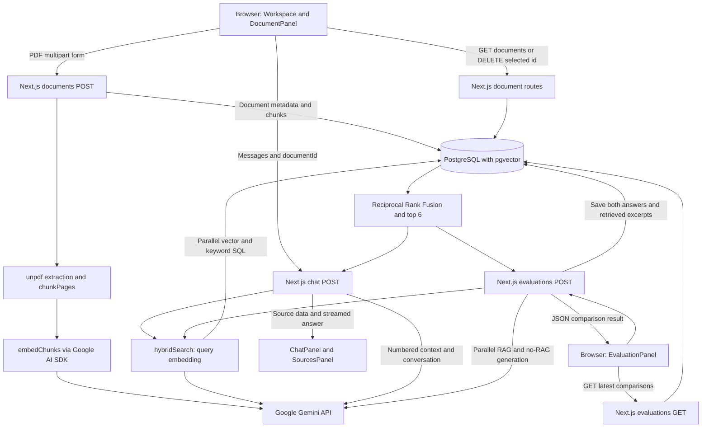

# DocRAG — Codebase and Architecture Audit

Audit date: 2026-10-21. Scope: STEP 1, documentation only.
Repository: https://github.com/abhi0874/DocRAG. Branch: `feat/production-rag`.
Inspected application revision: `4904ebb` (the four STEP 0 commits are local).

Evidence comes from source inspection, installed dependency source, read-only
PostgreSQL catalog queries, fresh lint/test/build/coverage runs, and HTTP smoke
checks. A smoke check verifies a basic working path; it does not prove answer
quality or production security. No application behavior, schema, prompts, or
production features were changed for this audit.

## 1. Project Overview

DocRAG is a document question-answering application. Retrieval-augmented generation
(RAG) means finding relevant document passages and supplying them to a language
model before it answers. The application accepts PDFs, stores extracted text and
numeric representations of meaning, retrieves passages using both semantic and
keyword search, and streams answers with clickable excerpt references.

This is one Next.js application containing browser components and server API route
handlers. There is no separate Python API. Python scripts support development.
The current comparison page displays answers with and without retrieval; it is
not yet a reproducible measurement of RAG quality.

STEP 0 independently passed before this audit began: setup, live Gemini access,
database configuration, lint, 14 Python tests, 13 TypeScript tests, type checking,
and production build. The clean checkout contained commits `4e4fafa`, `3765d9a`,
`02d8d13`, and `4904ebb`. Read-only GitHub checks showed remote `main` still at
`7ccc792669cef1c254d71ebc342fa4ba624584fa` and no published
`feat/production-rag` branch. No push was performed.

## 2. Actual Technology Stack

Versions below are pinned in `package.json`, not guesses about newest releases.

| Area | Current implementation |
| --- | --- |
| Web application and API | Next.js 16.2.6 App Router, React 19.2.4, TypeScript 5.7.3 |
| Styling and UI | Tailwind CSS 4.2.0, component code, Base UI, Lucide icons |
| Browser data and chat | SWR 2.4.2, @ai-sdk/react 4.0.17, DefaultChatTransport |
| Model access | AI SDK 7.0.16, @ai-sdk/google 4.0.8 |
| Configured models | gemini-3.5-flash for answers; gemini-embedding-2 for vectors |
| Storage | PostgreSQL 16.15 with pgvector 0.8.6 in the inspected development database |
| Database client | pg 8.22.0 and Drizzle ORM 0.45.2; an ORM maps code operations to SQL |
| PDF extraction | unpdf 1.6.2 |
| JavaScript installation | pnpm 11.25.0, pnpm-lock.yaml, pnpm-workspace.yaml |
| Checks | ESLint 9.39.1, Vitest 3.2.4 with V8 coverage, Ruff 0.14.2, pytest 8.4.2 |

`lib/model-config.json` supplies model names and 1536 embedding dimensions.
The live environment check validates the chat model; it does not validate a real
embedding request or complete PDF-to-answer workflow. Free-tier availability and
quota are account/provider conditions, not guaranteed by a source-code comment.

## 3. Architecture Diagram

Arrows show requests or data flow, not independent deployed services. Ingestion,
retrieval, and answer generation execute in the Next.js server process. Python
helpers, tests, and the native database launcher are development tools outside
this application request path. There is no worker queue or original-PDF store.

## 4. Repository Structure

| Paths | Responsibility |
| --- | --- |
| `app/page.tsx`, `app/evaluate/page.tsx`, `app/layout.tsx` | Workspace, comparison page, shared layout/fonts and production analytics component |
| `app/api/documents/route.ts` | List documents and ingest PDFs |
| `app/api/documents/[id]/route.ts` | Delete document-related records |
| `app/api/chat/route.ts` | Retrieval and streaming answer response |
| `app/api/evaluations/route.ts` | Generate, save and list side-by-side comparisons |
| `components/workspace.tsx`, `components/chat-panel.tsx` | Document selection, chat transport and citation rendering |
| `components/document-panel.tsx`, `components/sources-panel.tsx`, `components/evaluation-panel.tsx` | Upload/delete UI, source inspection and comparisons |
| `lib/rag.ts`, `lib/model-config.json`, `lib/types.ts` | Chunking, embeddings, retrieval, prompt, configuration and shared types |
| `lib/db/index.ts`, `lib/db/schema.ts`, `db/init.sql` | Pool/ORM, declared tables/indexes and additive local initialization |
| `tests/rag.test.ts`, `tests/routes.test.ts`, `tests/test_helpers.py` | Current automated unit/route smoke tests |
| `scripts/` | Private environment checks, read-only SQL queries and native development database management |
| `Makefile`, `docs/COMMAND_CONTRACT.md`, `docs/BEGINNER_NOTES.md` | Repeatable commands and local operating instructions |

Tracked files and source searches contain no authentication middleware/proxy,
CI workflow, Dockerfile, deployment manifest, golden dataset, evaluation runner,
or regression checker. The future `make eval`, `make eval-gate`, and `make load`
targets deliberately fail with a not-implemented message.

## 5. End-to-End Request Flow

1. `Workspace` loads `GET /api/documents` through SWR, a browser data-fetching cache.
2. `DocumentPanel.handleFile` posts a `file` in multipart form data. The server
   extracts pages, chunks them, creates a document record, embeds the chunks,
   inserts chunk records, and marks the document ready.
3. The browser refreshes the document list and selects the returned document ID.
4. `ChatPanel.submit` sends trimmed text through `Workspace.handleSend` and
   `DefaultChatTransport` to `POST /api/chat`, including the selected ID.
5. The server embeds the latest user question, searches that document, combines
   the two ranked lists, and constructs numbered excerpts.
6. The response carries source data followed by streamed Gemini answer text.
   Citation buttons scroll the sources panel to a numbered excerpt.
7. Separately, the comparison page requests two answers, stores both, and displays
   recent comparisons. It does not calculate a quality score.

The document ID is a database identifier, not proof of ownership. The client
chooses it and the server has no user authorization check.

## 6. Document Upload and Ingestion

Evidence: `DocumentPanel.handleFile` in `components/document-panel.tsx` and `POST`
in `app/api/documents/route.ts`.

The browser file picker suggests `application/pdf`; the server checks that `file`
is a JavaScript `File`, its name ends in `.pdf` case-insensitively, and its size is
not greater than `15 * 1024 * 1024` bytes (15 MiB). Exactly that size is accepted.
The UI says 15MB, but the implementation uses binary units. Filename checking is
not a file-signature check, and the browser's picker restriction is not security.

`req.formData()` receives the body before the file-size check. `file.arrayBuffer()`
then loads the file into memory. `getDocumentProxy` and `extractText` from unpdf
use `mergePages: false`, producing an array of page-text strings plus `totalPages`.
There is no OCR (recognizing text inside scanned images) in the application.
Whitespace-only or too-short extracted content produces no chunks and returns
HTTP 400 before a document row is inserted.

For usable text, the route inserts metadata with `status = 'processing'`, title
from the filename, page count and expected chunk count. All embeddings are obtained
before chunk insertion. Rows are inserted sequentially in groups of 50. The
status changes to `ready` only after all inserts succeed. The original PDF bytes
are not persisted by this route.

Confirmed reliability limitations:

- No transaction covers document insertion, embeddings, chunk batches and the
  final status update. An embedding failure after the first insert leaves a
  `processing` row. A later insert failure can leave only some chunks. The
  stored `chunkCount` can then disagree with the number of stored chunks.
- The catch block returns HTTP 500 but does not mark failed documents or clean
  up partial work. No resumable job or ingestion retry endpoint exists.
- No file hash or uniqueness rule prevents duplicate uploads. Retrying an upload
  can create another document and repeat paid/quota-limited model work.
- There is no explicit page-count, extracted-text, chunk-count or concurrent-upload
  budget. Memory/CPU pressure from difficult PDFs is a potential risk, not a
  benchmarked failure. No explicit PDF proxy cleanup is visible in the route.
- The UI can select a processing document because selection is not gated by status.

The upload route exports `maxDuration = 120`; the comparison route does too.
These host hints are not explicit local parser/model timeouts.

The handler logs the complete caught error object. Its client message is generic,
except for string-based API-key error classification. An error object's possible
contents have not been exhaustively checked for sensitive data.

## 7. Chunking and Embeddings

`chunkPages` in `lib/rag.ts` normalizes whitespace, skips empty pages and processes
each page separately. Chunk size is at most 1000 JavaScript string code units,
not 1000 model tokens. A token is a model's unit of text processing. Overlap is
200 code units. When not at the page end, the code looks for the last `. ` in
the final 200-code-unit window and prefers that sentence boundary (at a position
greater than zero within the window). Leading/trailing whitespace is trimmed.
Only chunks longer than 20 code units are retained. Page numbers are one-based;
chunk indexes are zero-based and consecutive across retained chunks.

This preserves page provenance and overlapping context, but short pages can be
omitted, layout is flattened, and chunks never cross page boundaries. The impact
on tables, multilingual text, and answers spanning pages needs a public test corpus.

`embedChunks` requests document embeddings in sequential batches of up to 100,
with `RETRIEVAL_DOCUMENT` and `outputDimensionality: 1536`. The provider SDK may
further manage requests within a batch. Returned vectors are accumulated in order
and paired with chunks by array position. The application does not explicitly
check returned vector count/length or cache embeddings. PostgreSQL enforces the
stored vector dimension, but it cannot prove that the right vector belongs to a
particular text chunk. Model identity/version is not stored with each vector.

Retries are not wholly absent: installed AI SDK `prepareRetries` defaults to two
retries, and its retry utility uses exponential backoff starting at 2000 ms with
a factor of 2 for retryable provider errors, respecting reasonable retry headers.
The application omits explicit retry settings and relies on those defaults for
embed/embedMany/generateText/streamText calls. This is provider-call retrying,
not transactional ingestion recovery or a guarantee of recovering a broken stream.

## 8. Hybrid Retrieval

`hybridSearch(query, documentId, topK = 6)` in `lib/rag.ts` already implements
semantic and keyword retrieval. It is not a missing future feature.

| Stage | Actual configuration |
| --- | --- |
| Query embedding | Same embedding model, 1536 dimensions, RETRIEVAL_QUERY |
| Vector candidates | document_id filter, non-null embedding, cosine distance `<=>`, ascending distance, LIMIT 12 |
| Displayed vector score | `1 - cosine distance`; this is not an answer-confidence probability |
| Keyword candidates | document_id filter, English plainto_tsquery against content_tsv, ts_rank descending, LIMIT 12 |
| Fusion | Reciprocal Rank Fusion (RRF), adding `1 / (60 + rank)` for each list containing an ID; rank starts at 1 |
| Final output | Descending RRF score, then topK slice; chat uses 6 and comparisons use the default 6 |

RRF combines positions in ranked lists instead of assuming that cosine and keyword
scores share a scale. Duplicate chunk IDs are merged. At most 24 distinct
candidates can enter fusion. The two SQL searches run in parallel after the query
embedding returns. The implementation's zero-based loop rank plus one correctly
matches the one-based formula; a mocked test verifies an overlapping hit ranks first.

The live database has a generated English `content_tsv`, a GIN index (a lookup
structure for text-search terms), an HNSW cosine vector index (an approximate
nearest-neighbor structure), and a B-tree index on `document_id`. Schema and SQL
operators align. This verifies configuration, not real-corpus retrieval quality or
which index PostgreSQL actually chooses for a query.

Returned metadata includes chunk ID, content, page number, chunk index, individual
vector/keyword scores when present, and RRF score. It omits document title/ID,
original PDF URL, text offsets, embedding version and retrieval timings.

Confirmed limitations: every query is embedded again; candidate counts and fusion
constant are fixed; no score cutoff, reranker, diversity control, caching, or
explicit SQL tie-breaker exists. English text processing is fixed. Only the latest
user question is embedded, so references such as “what about its exceptions?” are
not expanded using chat history. How much these choices affect recall and latency
is an unverified hypothesis. Filtered approximate search may return fewer useful
hits depending on data and query plans; no such failure was measured here.

## 9. Answer Generation and Citations

`Workspace.handleSelect` clears chat messages when switching documents.
`handleSend` supplies the selected ID. `POST /api/chat` checks only that the ID is
truthy, locates the last user message, joins its text parts, and retrieves passages.
It does not first check document existence, readiness or ownership.

`buildContext` numbers excerpts starting at 1 and includes page numbers.
`RAG_INSTRUCTIONS` explicitly asks Gemini to use only these excerpts, cite every
claim with bracketed excerpt numbers, and say “I could not find this in the
document.” when the excerpts do not contain an answer. These controls exist.
They are model instructions, not independently verified guarantees.

The chat route sends those instructions plus context and the converted client
conversation to `streamText`. A `data-sources` message is written first, then the
model stream is merged into the AI SDK UI-message stream. Retrieval completes
before that stream is created, so retrieval latency delays the first source/answer
output. `maxDuration = 60` is exported, but local code has no explicit abort timeout;
host enforcement must be verified for a future deployment.

`CitedText` in `components/chat-panel.tsx` turns each `[digits]` match into a button
and passes `number - 1` to the source panel. `SourcesPanel` shows excerpt text,
page/chunk numbers and score bars. Clicking scrolls to an excerpt; it does not open
an original PDF page. Text is rendered through React text nodes, not raw HTML.

Confirmed limitations:

- No server or browser check proves a cited excerpt supports a claim. Out-of-range
  citation numbers still become buttons; the source-panel bounds check simply
  prevents scrolling to a missing element.
- `Workspace.latestSources` always selects the most recent assistant source list.
  Clicking a citation in an older answer therefore uses the latest list, not the
  older answer's own list. Source associations can be wrong across turns.
- Empty retrieval does not trigger a deterministic refusal branch; the model is
  still called and is expected to obey the prompt.
- Client conversation messages are not server-owned history. Runtime validation
  is incomplete, and there is no explicit history/context token budget.
- ChatPanel is passed status but no displayed chat error; it only permits sending
  when status is `ready`, with no explicit user recovery control for errors.

Malicious instructions inside document excerpts could affect generation (prompt
injection). Its exploitability and frequency have not been tested. This audit did
not alter prompts or claim citation/faithfulness scores.

## 10. Database Architecture

Read-only catalog inspection matched `lib/db/schema.ts` and `db/init.sql`:

| Table | Main columns and behavior |
| --- | --- |
| documents | Serial primary key; non-null title/filename; page_count and chunk_count default 0; text status defaults processing; created_at defaults now() |
| chunks | Serial primary key; non-null document_id/chunk_index/page_number/content; nullable vector(1536); generated stored English tsvector; created_at |
| evaluations | Serial primary key; non-null document_id/question/rag_answer/no_rag_answer; retrieved_chunks JSONB defaults []; created_at |

A primary key uniquely identifies a row. A foreign key requires a referenced row
to exist: neither `chunks.document_id` nor `evaluations.document_id` currently has
one. The only live table constraints found were the three primary keys. There is
no unique document/chunk-index pair, status enum/check, or per-user ownership
column. Row-level security, database rules that restrict which rows each user can
access, is disabled on all three tables.

There are six indexes: the three primary-key indexes plus
`chunks_content_tsv_idx` (GIN), `chunks_embedding_idx` (HNSW with
`vector_cosine_ops`), and `chunks_document_id_idx` (B-tree). No evaluation
`document_id` or listing `created_at` indexes exist; their performance importance
requires measurement at realistic data volumes.

`lib/db/index.ts` creates a module-level pg Pool using DATABASE_URL and passes it
to Drizzle. There is no explicit application pool sizing, acquisition/statement
timeout, pool error listener, or shutdown hook. Installed pg-pool defaults include
10 connections and a 10000 ms idle timeout; acquisition timeout is not explicitly
configured. Deployment concurrency could multiply pools across processes; that
is a sizing question, not a measured exhaustion incident.

`DELETE` in `app/api/documents/[id]/route.ts` converts the ID with Number and checks
Number.isInteger, but not positive/safe-integer bounds or ownership. It deletes
chunks, evaluations and then the document in three separate operations and returns
`{ ok: true }` even when no matching document existed. Without a transaction or
foreign keys, failures and concurrent ingestion/deletion can leave inconsistent
records. No destructive request was made in this audit.

Initialization SQL is wrapped in a transaction and uses IF NOT EXISTS. This is
useful local bootstrap, not a versioned migration history capable of reconciling
arbitrary schema drift. It does not make the separate ingestion/deletion handlers
transactional. Native PostgreSQL is an approved development choice, not a defect.

## 11. Existing Evaluation Functionality

`EvaluationPanel`, `app/evaluate/page.tsx`, and `POST /api/evaluations` implement a
manual comparison. The user selects a document and types a question; the server
retrieves context and runs two `generateText` calls in parallel. One uses the RAG
instructions and context, and the other uses general knowledge with an uncertainty
instruction. Both answers, question and retrieved chunks are saved. GET returns
the latest 20 records. The page displays the text, retrieved-chunk count and date.

This records qualitative comparison artifacts. It calculates no answer-quality
metric. The “grounded” label describes the supplied prompt/context, not a verified
property of the generated answer. The two prompts also differ beyond context,
which matters when designing a later controlled experiment.

Full tracked-tree and source inspection found none of the following implemented:

| Capability | Current status |
| --- | --- |
| Fixed golden dataset | NOT IMPLEMENTED: no fixed questions with expected evidence/answers |
| Recall@k | NOT IMPLEMENTED: no fraction of relevant evidence recovered in the top k |
| Mean Reciprocal Rank | NOT IMPLEMENTED: no average inverse rank of first relevant hit |
| Citation accuracy | NOT IMPLEMENTED: no check that cited evidence supports claims |
| Faithfulness scoring | NOT IMPLEMENTED: no score for consistency with supplied evidence |
| Answer correctness scoring | NOT IMPLEMENTED: no comparison against expected answers |
| Retrieval/generation latency measurements | NOT IMPLEMENTED in application evaluation records |
| Reproducible baseline and regression thresholds | NOT IMPLEMENTED |
| Model/prompt-hash disk cache for evaluation/judging | NOT IMPLEMENTED |

Stored comparisons are not cache lookups: rerunning the same request calls the
models again and inserts another record. There is no judge model here. STEP 2
should add a reproducible evaluation harness, meaning fixed inputs, recorded
configuration, measured outputs and repeatable checks. Nothing from that step was
scaffolded during this audit.

## 12. Testing and Coverage

Fresh `make test` and `make cov` runs both passed: **14 Python tests and 13
TypeScript tests**, zero failures. Coverage matches the prior STEP 0 counts.

| Test file | What it actually checks |
| --- | --- |
| tests/rag.test.ts (7) | Empty/whitespace input; normalization and page numbering; long-page overlap/reconstruction; sentence boundary; numbered context; no embedding call for an empty batch; RRF merge/rank with mocked results |
| tests/routes.test.ts (6) | Missing file; non-PDF extension; mocked empty PDF extraction; missing chat selection; blank comparison question; noninteger deletion ID |
| tests/test_helpers.py (14 collected cases) | SELECT validation; write/multiple-statement rejection; mocked read-only transaction and timeout; validation before connecting; production-URL equality guard; placeholder detection; redaction; native cluster ownership marker |

These are isolated unit tests and direct route-handler tests. Database, embedding,
PDF extraction and retrieval dependencies are mocked where relevant. They do not
exercise live SQL, a real PDF parser, actual model generation, streaming, browser
interaction, successful multi-batch ingestion or transactional failure recovery.
`check_env.py` is a live environment/integration smoke check, distinct from the unit
suite. HTTP probes exercise Next.js and the real development database.

Fresh output artifacts:

- TypeScript: **229/1035 lines**, **22.12%** as reported in
  `coverage/typescript/coverage-summary.json`; source scope is lib, API routes and
  components. Page/layout files are outside this configured scope.
- Python helpers: **67/195 statements** covered, from
  `coverage/python/index.html` and the coverage data. It is helper coverage, not
  coverage of a nonexistent Python backend.

No rounding or improvement claim is added. Executing imported schema declarations
can count as covered without testing their database behavior. UI components have
zero line coverage; aggregate branch/function percentages must not be mistaken
for UI correctness. These figures do not establish production readiness.

`vitest.config.ts` uses V8 coverage; pytest-cov covers scripts. No coverage gate is
currently enforced; the planned 70% gate belongs to STEP 9. ESLint uses Next.js
core-web-vitals and TypeScript rules. Ruff checks Python issues/import ordering
and formatting. TypeScript has strict mode; skipLibCheck skips library declaration
checking, not application checking. Next.js no longer suppresses type errors.

Priority future tests: successful ingestion and embedding batching; DB retrieval
against known evidence; partial failures/deletion races; validation of malformed
JSON and IDs; source association across turns; streaming/error handling; browser
workflows and access-control tests once security is implemented.

## 13. Security Assessment

Classification distinguishes observed controls and code gaps from unproven attacks.
Publicly accessible below means no route-level authentication if the application
is made reachable; the development command currently binds to loopback only.

| Classification | Evidence | Practical consequence |
| --- | --- | --- |
| NOT IMPLEMENTED | No auth/session middleware or user model in tracked code | The application cannot identify a caller or sign a user in. |
| CONFIRMED ISSUE | All API handlers accept requests without ownership checks; documents and evaluations are globally listed | Anyone able to reach a deployed API could enumerate records, ask about other documents, or delete by ID. |
| NOT IMPLEMENTED | No document owner column, user filter or row-level security | Document ID filtering limits search to a document but does not isolate users. |
| ALREADY IMPLEMENTED | File presence, extension, 15 MiB size check and empty-text rejection | Some invalid uploads are rejected; these checks are useful but incomplete. |
| CONFIRMED ISSUE | No complete runtime schema validation in chat/evaluation routes; truthy ID checks; Number.isInteger alone for deletion | Malformed bodies can throw or reach downstream work instead of returning predictable validation errors. TypeScript annotations do not validate incoming JSON. |
| POTENTIAL RISK | No PDF signature/resource isolation; form body parsed before size check; no page/chunk budget | Crafted or unusually complex input could consume substantial resources. This was not exploit-tested. |
| NOT IMPLEMENTED | No server rate limit, per-user quota, or concurrency limit | Reachable model endpoints have no application-controlled abuse/cost boundary. |
| ALREADY IMPLEMENTED | Drizzle SQL templates bind query/document/vector values; ORM operations use values/conditions | User strings are not concatenated as executable SQL in the inspected routes. This protects against ordinary SQL injection, not authorization errors. |
| ALREADY IMPLEMENTED | .env and .local ignored; placeholder-only .env.example; private key stays server-side | Current secrets are kept out of tracked files and no NEXT_PUBLIC credential is used. |
| POTENTIAL RISK | Upload catch logs the complete error; other handlers rely on framework errors | Logs might contain provider/database details or user content. No actual credential leak was observed. |
| POTENTIAL RISK | Untrusted passages are included in model instructions; no prompt-injection evaluation | Documents could influence behavior beyond their intended role as evidence. |
| ALREADY IMPLEMENTED | React renders answer text without dangerouslySetInnerHTML | Generated HTML is not directly executed by this rendering path. This does not validate citations. |
| NOT IMPLEMENTED | No explicit application security-header/CSP policy or origin/CSRF policy in configuration | Deployment must define browser/origin protections; absence here is not proof that every cross-origin attack succeeds. |

The native helper creates a local bootstrap administrator and trusts local socket
connections within the private state directory, while TCP uses a generated password.
It is a local-development arrangement, not a production least-privilege role design.
Production credentials, transport security, backups and authorization need separate
configuration. No security feature reserved for STEP 7 was added here.

## 14. Performance and Reliability Risks

Confirmed implementation costs include sequential embedding batches, buffering all
extracted chunks/vectors before insertion, sequential insert groups of 50, fresh
query embedding for every question, two database searches per retrieval, and two
parallel generation calls per comparison. Listing documents has no pagination;
evaluation listing is limited to 20, but stored comparisons have no retention rule.

Failures in either parallel search reject the combined retrieval; there is no
fallback to the surviving search. Either failed comparison generation rejects the
pair before saving; a successful companion request may already have consumed quota.
No application cache, circuit breaker, request IDs, durable queue or recovery state
exists. A circuit breaker would temporarily stop repeated calls to a failing service.

The document selector can change while a chat is running, and deletion does not
clear selectedId or surface unsuccessful deletion responses. Their effects during
races need browser tests. Model scores shown as bars are not calibrated confidence;
cosine similarity can also be negative while the bar code only caps the upper bound.

No p50/p95 latency, throughput, memory, cost-per-question or retrieval-quality
benchmark was produced. It would be incorrect to label the app fast, scalable,
or accurate based on successful builds and small smoke tests.

## 15. Production Readiness

| Area | Current situation |
| --- | --- |
| Reproducibility | Pinned dependencies and lockfile, virtual environment, command contract, lint/type/test/build checks exist. |
| Environment | Actual app uses DATABASE_URL and GOOGLE_GENERATIVE_AI_API_KEY. DATABASE_URL_PROD is an unused placeholder; JWT_SECRET is not required. |
| Startup validation | check_env.py validates settings when explicitly run; application routes do not automatically run it on startup. |
| Timeouts/retries | SDK retries exist; application calls lack explicit end-to-end timeout/output budgets. Exported maxDuration values are host-dependent. The separate Gemini probe has explicit limits. |
| Logging/observability | One ingestion console.error, framework/dev logs and production Vercel Analytics component. No application request tracing, retrieval/model timing, error monitoring or service health endpoint. Analytics is not RAG observability. |
| Database lifecycle | Local native commands and bootstrap SQL work. No versioned migration runner, backup/restore validation, production pooling policy or per-user access controls. |
| CI | No tracked continuous-integration workflow automatically running checks on changes. |
| Containerization | No Dockerfile/Compose configuration. Native PostgreSQL works and Docker is not required for this audit. |
| Deployment | next build/start scripts and route runtime hints exist; no verified deployment, live URL, hosted database, release workflow or production environment configuration. |
| Documentation | Detailed STEP 0 guides exist; root README still says RAG-Agent and includes generic npm/yarn/port-3000 instructions; package name remains my-project. These are documentation/product-polish gaps. |

The eventual recruiter-facing service must remain available without this Mac.
That requires an online Next.js runtime and persistent hosted PostgreSQL/pgvector,
with tested migrations, secrets, access controls and operations. No hosting provider
was selected or deployment performed in STEP 1. Per the user's rule, development
remains local through STEP 12 and final publication requires explicit permission.

## 16. Strengths of the Current System

- A coherent TypeScript/Next.js implementation covers upload through streaming UI.
- Page-aware overlapping chunks retain useful provenance.
- Hybrid vector/keyword retrieval with correctly indexed search columns and RRF
  exists, and the merge formula has a focused unit test.
- The prompt explicitly requests citations and admits unavailable answers.
- Sources are sent as structured data and expose individual retrieval scores.
- SQL values are parameterized; private settings are ignored by Git.
- Pinned setup, strict application type checks, unit tests, live environment checks
  and repeatable production builds provide a useful development foundation.

These strengths describe implementation and verified checks, not measured RAG accuracy.

## 17. Confirmed Weaknesses

| Priority | Confirmed finding | Source evidence |
| --- | --- | --- |
| Before any public exposure | No authentication, ownership enforcement or rate limits | API handlers; schema; absence of middleware/proxy in tracked tree |
| Data integrity | Ingestion/deletion are not atomic; no foreign keys or failure lifecycle | `app/api/documents/route.ts` POST, `app/api/documents/[id]/route.ts` DELETE, `lib/db/schema.ts`, `db/init.sql` |
| Correctness | Older citation buttons use the latest source list | Workspace.latestSources and ChatPanel.CitedText |
| Input robustness | Partial request validation and missing document readiness/existence checks | chat/evaluations POST and documents/[id] DELETE |
| Evaluation | Side-by-side answers have no reproducible dataset, quality metrics, thresholds or cache | evaluations route/page, Makefile, tracked-file search |
| Resource control | No explicit request/history/chunk/concurrency budgets or durable processing | upload handler, rag.ts, chat handler |
| Reliability | Incomplete client error recovery and deletion feedback | ChatPanel, DocumentPanel.handleDelete, SWR fetchers |
| Verification depth | Unit tests mock external services; no complete real upload/chat/browser test | tests and coverage configuration |

“Confirmed” means supported by inspected code or database metadata. It does not
mean an adversarial exploit, production incident, or quantified impact was demonstrated.

## 18. Unverified Hypotheses

- Different chunk sizes, token-aware splitting, overlap or cross-page context may
  improve evidence recall. Measure on fixed public documents and questions.
- Query rewriting for follow-up questions, larger candidate pools, a reranker or
  diversity selection may improve ranking; no superiority is established yet.
- HNSW document filtering, lack of listing/evaluation indexes, repeated query
  embeddings or pool sizing may become latency bottlenecks. Use real plans and
  timing distributions before choosing an optimization.
- PDF parsing or large conversation histories may exceed resource budgets under
  concurrency. Measure later with controlled load and limits.
- Prompt injection may cause ungrounded answers; citation syntax may look correct
  even when unsupported. Evaluate attacks and claim/evidence agreement separately.
- Exact behavior during a streaming failure, document switch, or concurrent deletion
  needs integration/browser tests. SDK retries alone do not prove recovery.

No hypothesis above is reported as an accuracy gain, speedup, or observed outage.

## 19. Recommended Future Improvements

1. STEP 2: establish a versioned public golden corpus, expected evidence and answers,
   Recall@k/MRR, citation/faithfulness/correctness evaluation, recorded model/prompt
   configuration, latency measurements, baseline artifacts and regression thresholds.
   Cache model/judge calls by model and prompt hash and use bounded backoff.
2. In the appropriate reliability work: design explicit ingestion states, idempotency
   (safe retry without duplicate effects), recovery, transactional writes/deletion,
   foreign keys and a migration strategy. Keep model network calls outside long DB
   transactions when designing the final approach.
3. Before public exposure, implement STEP 7 authentication, ownership checks,
   per-user document access, runtime validation, quotas/rate limits, safer parsing
   budgets and redacted error handling. Resolve the older-citation association bug
   with per-message sources and regression tests in its appropriate implementation step.
4. Expand integration/browser coverage and meaningful failure tests, then enforce
   the planned STEP 9 coverage gate. Do not inflate coverage with assertion-free tests.
5. Add request IDs and measured stage timings before performance work; use STEP 10
   load tests to validate concurrency, connection budgets and resource limits.
6. In the later delivery work, add CI, production migration/backup procedures and
   an online deployment plan; align README and metadata with the verified commands.
   Do not push, open a PR, merge, or deploy during these local development steps.

## 20. Summary and Next Steps

DocRAG already demonstrates the core RAG architecture: PDF extraction, overlapping
chunks, Gemini embeddings, indexed hybrid retrieval, RRF, streaming answers,
clickable citations, and manual comparison. It is a development foundation rather
than an authenticated, evaluated, production-ready service.

The next authorized implementation step should establish reproducible quality
measurement before retrieval tuning. The audit findings are a backlog, not changes
made in STEP 1. No STEP 2 code or dataset was created.

### Verification record

The independent STEP 0 audit ran all ten specified commands (four Git inspection
commands, setup, environment check, lint, tests, build, vector query); all exited 0.
Runtime versions and test/coverage counts match STEP 0. Required setup files exist,
the working tree was clean, and database metadata matches application queries.

Final STEP 1 checks: **11/11 passed** (the eleven finite checks in this table).
The managed server start/stop, coverage run, read-only database catalog inspection
and remote-reference check also succeeded and are recorded separately.

| Check | Exit | Actual evidence |
| --- | --- | --- |
| curl -sf http://localhost:8000/ -o /dev/null -w "%{http_code}\n" | 0 | HTTP 200; a separate body read confirmed HTML containing DocRAG |
| curl -sf http://localhost:8000/api/documents -o /dev/null -w "%{http_code}\n" | 0 | HTTP 200; actual response parsed as an empty JSON array |
| test -s docs/AUDIT.md && echo ok | 0 | ok |
| Document structure/reference check | 0 | All 20 numbered sections in order; all 24 referenced repository file paths exist |
| Mermaid syntax check | 0 | Mermaid 11.12.0 parser accepted the flowchart; edges also reviewed against source |
| make lint | 0 | Ruff checks/format, ESLint and TypeScript passed |
| make test | 0 | 14 Python tests and 13 TypeScript tests passed; zero failures |
| make build-fe | 0 | Production compilation, TypeScript validation and page generation passed |
| git branch --show-current | 0 | feat/production-rag |
| git status --short | 0 | Only docs/AUDIT.md was untracked before committing; no application changes |
| git diff --check | 0 | No whitespace errors; staged document also checked before commit |

`make run-api` started the actual Next.js application on port 8000. After both
responses and their bodies were checked, Ctrl+C stopped the server; the interrupted
launcher reported exit 1, which is the expected deliberate interruption rather
than a failed HTTP check. The native database remains available. No database
restart, deletion or schema modification was needed for this audit.

The requested `/docs` example was replaced by the real `/` and `/api/documents`
checks, as already specified in the STEP 0 command contract. Python ran from
.venv. The document existence check comes directly from the STEP 1 instructions;
structure/reference and Mermaid checks supplement it. Mermaid/jsdom validation
tools were installed only under a temporary folder, not globally or in project
dependencies. Existing command-contract files needed no modification.

`make cov` exited 0 and supplied the counts in section 12. Node's module.register
deprecation warning remains non-failing; no checks were disabled or thresholds
weakened. A passing HTTP/quality-tool check does not resolve the security findings.

### Task completion audit

| STEP 1 task | Status | Evidence in this document |
| --- | --- | --- |
| 1 Inspect application | COMPLETE | Sections 1–5; actual routes, components and helper files inspected |
| 2 Trace ingestion | COMPLETE | Section 6, including failure boundaries and duplicate/large/empty files |
| 3 Trace retrieval | COMPLETE | Sections 7–8, actual candidate counts, RRF and live indexes |
| 4 Trace answers | COMPLETE | Section 9, prompt, streaming, sources and citation limitations |
| 5 Audit database | COMPLETE | Section 10; live columns/indexes/constraints/security metadata checked read-only |
| 6 Audit evaluation | COMPLETE | Section 11; comparison functionality distinguished from absent metrics |
| 7 Audit testing | COMPLETE | Section 12; tests inspected and coverage freshly measured |
| 8 Audit security | COMPLETE | Section 13; four required finding classifications used |
| 9 Audit production readiness | COMPLETE | Sections 14–15; native PostgreSQL treated as a development choice |
| 10 Create audit | COMPLETE | All 20 required sections, current architecture and future recommendations |
| 11 Verify application | COMPLETE | Actual home/API responses inspected; server stopped |
| 12 Verify document | COMPLETE | Nonempty file, 20 sections, existing references, parsed Mermaid and consistency review |
| 13 Regression verification | COMPLETE | Lint/tests/build and Git checks passed; documentation-only local commit |

Only docs/AUDIT.md is included in the STEP 1 commit. No source code, schema,
prompt, dependency, tests or completed-step documentation was changed. No GitHub
push, PR, merge or deployment occurred. STEP 2 has not begun.

Before authorizing STEP 2, review the confirmed security findings, the distinction
between comparison and evaluation, and the proposed measurement plan. Its executor
must independently verify this document and its checks again.
