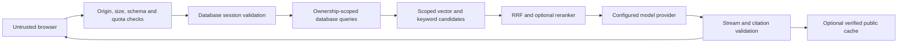

# DocRAG security model — Step 7

Scope: the existing Next.js application, PostgreSQL/pgvector, local operator
utilities, the optional public answer cache and the two supported model providers.
This is a local implementation and verification scope, not a deployment certification.

## Assets and boundaries

The browser is untrusted. A document ID, user ID, conversation, filename, PDF,
Origin header or model answer is input, never an authorization decision. The
Next.js server validates a database session before deriving a private identity.
PostgreSQL holds users, password hashes, opaque sessions, private originals,
chunks, vectors, evaluation records and ownership links. The database and local
operator account are trusted; theft of either remains serious. The optional model
provider receives authorized excerpts and questions. Local mode uses loopback
Ollama; Gemini mode transmits them to the configured Google service. The browser
never receives provider credentials, password hashes or session tokens in JSON.

Public data is an explicit classification, not an assumption about document text.
Only the two documents matching the existing public manifest's full document and
chunk hashes are automatically classified. Other legacy documents and evaluations
have no access row and remain inaccessible. New uploads are private and owned by
the authenticated session's user. Chunk and embedding access inherits the parent
document's ownership. Private evaluations have an additional owner relationship.

## Route and utility inventory

All HTTP responses containing user data use `Cache-Control: no-store`.
There are no server actions, replacement/update routes, separate search routes,
administrator HTTP routes, or independent chunk endpoints. Unsupported methods
are rejected by Next.js. Sources are delivered through authorized chat or read.

| Route / operation | Access and authorization | Input / tables | Expense / quota |
|---|---|---|---|
| POST auth/sign-in/email | Exact application origin; framework verifies credentials | Strict email/password; auth user/account/session | scrypt; shared anonymous auth 30/5 min |
| POST auth/sign-out | Exact origin; framework invalidates stored session | Empty JSON; auth session | auth 30/5 min |
| GET auth/get-session | Optional cookie; verified database session only | No client identity; auth session/user | anonymous read 120/min |
| Other auth operations | Unavailable, including public registration | No account created | POST auth quota still applies |
| GET documents | Public or authenticated owner, filtered in SQL | Validated offset; documents/access | 100 rows; read 120/min |
| POST documents | Required session and exact origin | Bounded PDF; documents/access/files/chunks | extraction, embeddings; upload 5/5 min; work slots |
| GET documents/:id | Public or owner | Integer ID; authorized document/chunks/access | read 120/min |
| GET documents/:id/download | Public or owner, original must exist | Integer ID; files/documents/access | bounded 15 MiB; read quota |
| DELETE documents/:id | Required session, private owner and exact origin | Locked scoped document; chunks/evaluations/access/files | transaction; authenticated quota |
| POST chat | Public or owner; exact origin; authorize before sources/cache | Strict messages and document ID; chunks/access | embeddings, model, optional rerank; user 30/min or anonymous 60/min; work slots |
| GET evaluations | Required session; evaluation owner AND document access | evaluations/evaluation_access/document_access | 20 rows; read quota |
| POST evaluations | Required session; authorized document and exact origin | Strict question/document ID; evaluation/access | two generations; 5/5 min; work slots |
| /evaluate page | Server session required; redirects to sign-in | Session | APIs repeat authorization |
| Local account/migration/evaluation utilities | Trusted local OS operator only; no HTTP bypass | Private environment and explicit database guard | Fixed SQL; test fixture writes only to named isolated database |

## Testable invariants and threats

1. **Cross-user access:** User B and anonymous callers cannot list, read, download,
   delete, chat about or evaluate User A's private document, including a guessed
   ID and forged `userId`. Missing and forbidden private documents return the same
   response. Tests: `scripts/security_http.py`.
2. **Retrieval leakage:** Both vector and keyword SQL correlate
   `access.document_id = chunks.document_id` inside WHERE before ORDER BY/LIMIT.
   RRF and reranking only receive these authorized candidates. Public-only is the
   default when no principal is supplied, including trusted evaluation tools.
   Tests: actual PostgreSQL/pgvector queries in `scripts/security_retrieval.ts`
   plus a SQL compilation regression in `tests/security.test.ts`.
3. **Credential/session theft:** Better Auth supplies scrypt and signed opaque
   cookies. HttpOnly, SameSite=Lax, path=/, no broad domain, Secure for HTTPS.
   Database expiry and logout revoke reuse; cookie session caching is disabled.
   JSON responses omit the token. Local HTTP requires an explicit loopback-only
   exception. Tests: real login, cookie flags, forged/expired/logout replay and
   production origin configuration.
4. **CSRF/CORS:** Every state-changing route requires the configured exact Origin
   and incoming Host, rejects cross-site fetch metadata, and retains framework
   CSRF protection. No wildcard credentialed CORS. A proxy must preserve the
   approved Host; client forwarded-IP headers are not trusted. Tests include evil
   origin, spoofed host, missing/null origin and forged identities.
5. **SQL injection:** Identifiers are bounded integers, schemas reject unknown
   settings, and Drizzle/pg bind values. No client table/expression interpolation.
   Tests cover injection strings and direct SQL parameterization.
6. **Malicious uploads:** Bounded request/file/page/text sizes; extension, MIME and
   signature all checked; malformed files rejected. Extraction runs in a child
   with a time limit, V8 heap limit and reduced environment. Original bytes,
   ownership and chunks commit atomically after embeddings finish. Tests ensure
   invalid uploads add no records and do not block subsequent valid work.
7. **Flooding:** Atomic PostgreSQL quotas work across application processes. The
   anonymous quota is global, deliberately unaffected by spoofed forwarded IPs.
   Two process-local expensive-work slots and one parser bound local concurrency.
   Tests cover 40 simultaneous quota calls, independent users, 429/Retry-After,
   recovery and idempotent resource release.
8. **Cache/citation disclosure:** Authorization precedes cache delivery. Private
   documents and conversation history bypass shared caching. Public eligibility
   also requires the frozen manifest and allowed question. Existing parser and
   cache write/read validation are retained. Tests retain both negative [-1]
   regressions, closed-code cases, old invalid eviction and valid caching.
9. **Error disclosure/enumeration:** Generic sign-in failure for absent account
   and bad password; bounded password input and authentication quotas. Internal
   exception details are not sent to clients. Application handlers never log
   credentials, session cookies, raw PDFs or private questions.

## Residual risks and deployment boundary

- A compromised OS/database administrator can access stored private data and
  opaque session records. This application does not encrypt each database field.
- Private data already delivered to a browser cannot be retracted; an in-flight
  request is not continuously reauthenticated after logout. The next request
  validates its session again. Sign-in/out force a full page navigation to clear
  browser application state.
- Rate limiting is not an internet DDoS defense. The global anonymous bucket can
  deny service to other anonymous users; process-local work limits do not impose
  a cluster-wide inference cap. Deployment needs reviewed edge/body/time limits,
  connection/pool sizing and trusted proxy configuration.
- The parser is a bounded child, not an OS sandbox. V8 heap limits do not cap all
  native memory. Keep dependencies patched; use deployment resource isolation.
- Prompt injection can influence generated text. Citation validation establishes
  structural references, not truth. Invalid content can appear during streaming;
  invalid references are not converted to valid clickable source buttons.
- No password reset, email verification, public signup, MFA or OAuth is enabled.
  Account issuance is an explicit local operator action. This avoids a public
  registration attack surface; it is not a complete public account lifecycle.
- Local inference and local PostgreSQL cannot serve online recruiters by
  themselves. HTTPS hosting, model capacity, persistent database/storage and
  secrets provisioning are future deployment work, not completed in Step 7.
