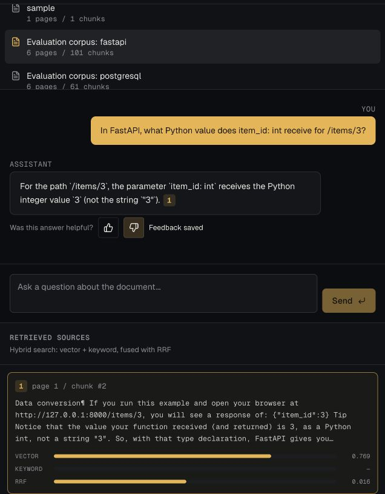
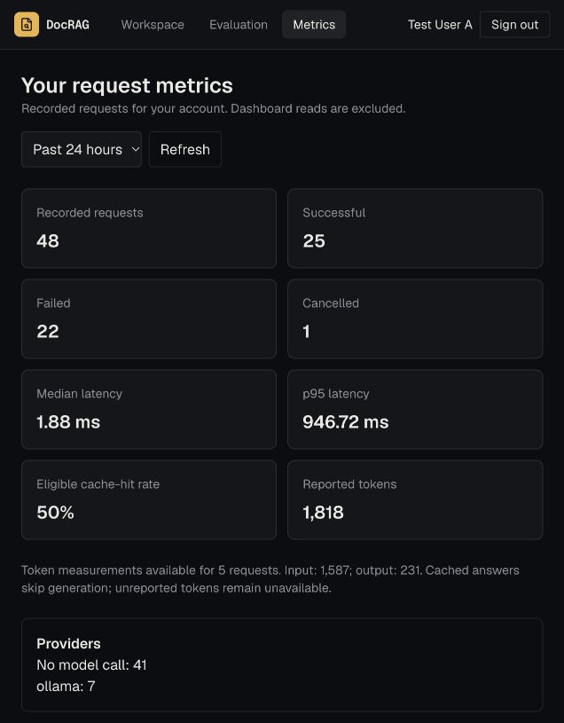

# STEP REPORT — STEP 8 FIX

Repository: https://github.com/abhi0874/DocRAG
Branch: `feat/production-rag`
Verified implementation: `bf8b8337dd5c5121518ff653204d043074579eaf`
Final run: `step8-final-a`, 5 November 2026 UTC; report finalized 6 November 2026.

Original Step 8 tasks: **18/18**. Remediation tasks: **24/24** (the request's earlier “23” is a numbering typo; it defines Task 24). Verification groups: **27/27**, each exit **0**. Step 7 independent prerequisite: **PASS**, 24/24 groups. No Step 9 work, push or deployment. Paid API charges: **₹0**.

The cancellation failure was reproduced, traced to a Node Web Streams regression and resolved by pinning Node 24.22.1 locally. Cancellation still stops generation and never creates a completed answer/cache entry. Metrics now retain their terminal outcome while asynchronous persistence finishes. Existing observability work was preserved, verified with real HTTP and browser interactions, and committed locally. All required Step 8 checks pass; the disclosed tooling advisories remain accepted risks, not zero findings.

## AbortError and correction

Original command:

```sh
pnpm exec vitest run tests/cache-api.test.ts tests/reranker-api.test.ts tests/observability.test.ts
```

On Node 26.5.0 / Vitest 5.1.0 / AI SDK 7.0.16 it exited **1** despite **51 assertions passing**, with one unhandled `AbortError: This operation was aborted`. The reported test was `releases a cancelled cache owner exactly once across abort and stream cleanup`. The visible cancellation stack included `Object.cancel app/api/chat/route.ts:121` and `Object.cancel lib/observability/http.ts:35`.

An observational promise-creation trace identified the extra rejected promise:

```text
Promise.reject
writableStreamDefaultWriterWrite (node:internal/webstreams/writablestream:986:12)
node:internal/webstreams/readablestream:1733:33
```

The Node internal pipe implementation marked this rejected write handled without attaching a real promise reaction. Catching the public pipe failure did not remove the internal rejection notification. The independent two-chunk reproduction exits 1 on Node 26.5.0 and 0 on Node 24.22.1; the unchanged original focused suite also passes on 24.22.1. This matches [Node issue #64561](https://github.com/nodejs/node/issues/64561). The diagnostic hook remains ignored local evidence, not application or permanent test setup. Its source-map diagnostic noise was not mistaken for the original failure.

`.node-version`, `.nvmrc`, package engines, Makefile and the runner select **24.22.1**. Its official Apple Silicon archive was SHA256 verified, installed only under `.local/node-v24.22.1-darwin-arm64`, and does not modify system Node. The permanent child-process regression uses normal unhandled-rejection behavior. No suppression handler, weakened test or forced successful exit was added.

The chat route checks cancellation before retrieval, after awaited retrieval and after asynchronous model setup. Work already running is awaited; the actual stream is cancelled/drained and its reader released. Only errors tied to an already-aborted request signal are expected teardown. Unexpected provider errors, including an unrelated AbortError, remain failures. Final state is copied before awaiting the metrics write, so late model cleanup cannot relabel `cancelled` as `model`. Repeated cancellation updates the same UUID, and cancellation after completed consumption does not mutate the answer.

Deterministic coverage spans stages A–J: before/during/after retrieval, model setup/streaming/first token, near EOF, persistence, after completion, repeated signals and unrelated errors. Current focused suite: **53 passed, 0 failed, exit 0, zero unhandled rejections**. Full suite: **174 Python + 219 TypeScript = 393 passed, 0 failed, exit 0**. The extra 53 focused and 35 gate tests repeat subsets; they are not added to the unique total.

## Actual verification commands

Executed from the existing checkout using project-local Node 24.22.1:

```sh
.venv/bin/python -m scripts.verify_observability --run-id step8-final-a
```

The runner exited **0**. It verified all **204** recorded source hashes stayed unchanged throughout execution. The evaluation's `working_tree_dirty_at_start: true` reflects untracked browser evidence, not undisclosed source edits. Every command and actual code below comes from [commands.json](security/step8-final/commands.json); all saved run receipts are under [step8-final](security/step8-final/complete.json). Original full logs remain ignored in `.local/observability-verify-step8-final-a/`. The committed build-log copy normalizes terminal carriage returns and trailing whitespace; its text/results are unchanged. A final artifact whitespace check caught these formatting issues after the successful application run; they were corrected and the artifact/Git checks repeated. No implementation file changed.

| Group | Actual command | Exit | Observed result |
| --- | --- | --- | --- |
| 1 | `make lint` | 0 | Ruff/format/ESLint/TypeScript pass |
| 2 | `make test` | 0 | 174 Python + 219 TypeScript = 393 passed; 0 failed |
| 3 | `pnpm exec vitest run tests/cache-api.test.ts tests/reranker-api.test.ts tests/observability.test.ts` | 0 | 53 passed; 0 failed; no unhandled rejection |
| 4 | `make build-fe` | 0 | Production Next.js build passed |
| 5 | `.venv/bin/python -m scripts.observability_setup` | 0 | Migration repeated; all 11 legacy tables unchanged |
| 6 | `.venv/bin/python -m scripts.security_setup --apply-selected` | 0 | Selected 162-chunk database preserved |
| 7 | `.venv/bin/python -m scripts.security_setup --apply-configured` | 0 | Configured application database preserved |
| 8 | `.venv/bin/python -m scripts.security_http` | 0 | 66 HTTP + 27 SQL checks; HTTPS cookie/logout checks pass |
| 9 | `.venv/bin/python -m scripts.observability_http` | 0 | 138 assertions; 69 requests; 68 metrics rows |
| 10 | `.venv/bin/python -m scripts.feedback_to_eval` | 0 | 1 review candidate; private export false; golden_modified false |
| 11 | `.venv/bin/python -m eval.validate_dataset --require-review` | 0 | 100 questions validated; existing review receipt retained |
| 12 | `.venv/bin/python -m eval.prompting_gate --baseline eval/results/reranking-selected.json --candidate eval/results/prompting/step5-v1.json` | 0 | Selected historical prompt gate passed |
| 13 | `.venv/bin/python -m eval.prompting_gate --baseline eval/results/reranking-selected.json --candidate eval/results/prompting/grounded-v1.json` | 0 | Historical comparison prompt gate passed |
| 14 | `.venv/bin/python -m pytest -q tests/test_prompting_gate.py tests/test_prompting_report.py tests/test_security_gate.py tests/test_observability_gate.py` | 0 | 35 gate/report tests including negative controls passed |
| 15 | `.venv/bin/python -m eval.prompt_bytes` | 0 | 200/200 rendered prompts byte-identical |
| 16 | `node --import tsx eval/recheck_citations.ts` | 0 | Both saved 100-answer sets structurally replayed; known comparison-prompt defect retained |
| 17 | `.venv/bin/python -m eval.citation_cache_http` | 0 | Invalid [-1] and triple-backtick cases MISS/MISS; valid MISS/HIT |
| 18 | `.venv/bin/python -m eval.cache_http --prompt-version step5-v1 --out .local/observability-verify-step8-final-a/cache-http.json` | 0 | Actual public cache MISS/HIT and bypass checks passed |
| 19 | `.venv/bin/python -m eval.reranking_smoke --out .local/observability-verify-step8-final-a/streaming.json` | 0 | Disabled/enabled/missing/timeout reranker streaming passed |
| 20 | `.venv/bin/python -m scripts.security_invalidation --prompt-version step5-v1 --out .local/observability-verify-step8-final-a/invalidation.json` | 0 | Content-change invalidation and original content restoration passed |
| 21 | `.venv/bin/python -m eval.run_eval --golden eval/golden_set.jsonl --prompting-experiment step5-v1 --out eval/results/observability/step8-final-a/evaluation-raw.json` | 0 | 100 fresh answers/judges; complete metrics below |
| 22 | `.venv/bin/python -m eval.promote_local --source eval/results/observability/step8-final-a/evaluation-raw.json --out eval/results/observability/step8-final-a/evaluation.json` | 0 | Authorized automated validation; provenance recorded |
| 23 | `.venv/bin/python -m eval.observability_gate --baseline eval/results/security/step7-final-b/evaluation.json --candidate eval/results/observability/step8-final-a/evaluation.json` | 0 | Recall@5 decrease 0.000; faithfulness decrease -0.005; .02 thresholds unchanged |
| 24 | `.venv/bin/python -m eval.reranking_integrity --out .local/observability-verify-step8-final-a/preservation.json` | 0 | Historical hashes, Gemini cache/vectors, selected chunks and secret scans passed |
| 25 | `.venv/bin/python -m eval.prompting_report --out .local/observability-verify-step8-final-a/historical-report.json` | 0 | Historical full-precision comparisons regenerated without replacing baselines |
| 26 | `.venv/bin/python -m scripts.security_audit` | 0 | Risk policy passed; raw JS exit 1 (two moderates); both Python audits exit 0 |
| 27 | `git diff --check` | 0 | No whitespace errors |

The raw audit is deliberately not normalized to zero: `pnpm audit --json` returned **1**, reporting two moderate advisories. `.venv/bin/python -m pip_audit --format json` and the installed reranker environment audit returned **0**. The wrapper passes only the existing disclosed reachability policy, and preserves [raw commands/codes](security/step8-final/audit/commands.json) and [raw JavaScript findings](security/step8-final/audit/javascript.json).

## Observability and actual HTTP evidence

Structured JSON logging, server request IDs/correlation, monotonic latency measurement, actual model-token accounting, metrics persistence, cancellation classification, duplicate prevention, protected dashboard and cross-user isolation: **PASS**.

The observability integration performed **69 actual HTTP requests**, passing **138 assertions**. It created exactly **68 metrics rows**; one metrics write was deliberately blocked by a bounded lock on the disposable fixture database to verify safe failure and recovery. This is an expected test loss, not an unexplained missing request. Separate existing security coverage passed **66 real HTTP checks + 27 SQL checks**. Counts are kept separate; assertions are not requests.

| Real HTTP measurement | Value |
| --- | --- |
| Persisted request count | 68 |
| Average latency, ms | 29.449020205882373 |
| p50 latency, ms | 0.6854585000000952 |
| p95 latency, ms | 54.59366030000006 |
| Eligible cache hits / misses | 1 / 1 |
| Persistence duration p50, ms | 0.4276670000001559 |
| Persistence duration p95, ms | 1.4534813500001058 |

These are this HTTP test window's mixed-route measurements, not 100-question generation latency. The request count was verified both by a before/after row delta and a bounded SQL query. Dashboard aggregates matched independently queried owner-scoped SQL. A cancelled stream can have sent HTTP 200 but retains `completion=cancelled`, category `cancelled`, one request row and no completed rateable receipt. Unknown provider tokens remain null. Public HIT tokens avoided are historical savings, not current model usage.

The same-route 30-sample latency observation after instrumentation was mean **1.2784430338797392 ms**, p50 **1.2766454983648146 ms**, p95 **1.4401980997718056 ms**. The earlier 30-sample baseline was mean **1.3733027318570141 ms**, p50 **1.2729164882330224 ms**, p95 **1.88426511012949 ms**. Concurrent workloads differed, so the difference is not a controlled estimate of instrumentation cost and does not establish zero overhead. Persistence duration above directly measures the write cost. Pool/queue and connection/statement/query bounds prevent unbounded telemetry waiting.

Two actual sanitized, correlated JSON events (public test request; no prompt, answer, owner, cookie or credential):

```json
{
  "timestamp": "2026-11-05T12:05:16.347Z",
  "level": "info",
  "event": "request.started",
  "request_id": "7d51ea16-7361-4a34-a9bc-3461e239dd42",
  "route": "/api/chat",
  "method": "POST"
}
```

```json
{
  "timestamp": "2026-11-05T12:05:17.419Z",
  "level": "info",
  "event": "request.finished",
  "request_id": "7d51ea16-7361-4a34-a9bc-3461e239dd42",
  "route": "/api/chat",
  "method": "POST",
  "status": 200,
  "completion": "completed",
  "latency_ms": 1072.389416,
  "error_category": null,
  "provider": "ollama",
  "cache": "MISS"
}
```

## Feedback and browser verification

Thumbs up, thumbs down, strict feedback API validation, ownership, database persistence, unique/update behavior, export and golden preservation: **PASS**. Concurrent feedback updates retain one vote per real completed answer. Anonymous, cross-user, invalid-value, extra-identity, invalid-origin, rate-limited and deleted-document requests are rejected as expected.

The real browser completed **16 observed checks, 0 failed**; this is a documented interaction checklist, not a claim of 16 automated assertions. [Checks and scope](security/step8-browser/checks.json) cover login, real streaming, exactly one assistant answer, up→down saved state, citation highlight, Stop response, cancelled-feedback exclusion, owner dashboard, period/refresh, sign-out reset, user B isolation and unavailable usage. The late cancellation-category correction was rechecked in the final build. Browser-only SQL independently found **one completed answer and one owned feedback row, final value `down`**, plus **one cancelled request with zero feedback rows**. See [SQL receipt](security/step8-final/step8-browser-sql.json).





Dashboard screenshots include setup traffic and selected owner/timeframe; their counts need not equal the bounded HTTP run. Failed requests on this fixture dashboard include deliberately tested security failures. Both test users were signed out afterward; the temporary Next.js server was stopped.

Export produced **1** public negative-feedback candidate with evidence/model/prompt provenance, `review_needed` and `ground_truth: false`. Private negative feedback did not export. The golden SHA256 remains `1867147d2667a2745d6cf0b2139225395f2599a1b68803fb37356964febab78b`. Export output stays mode-0600 under ignored `.local/feedback-review/`; no credentials or private feedback are committed.

## Database and preservation

Migration: **PASS**. Correct target: **PASS**. Historical data: **PASS**. The native PostgreSQL cluster was verified as this checkout's `.local/postgres` on **55433**. The additive three-table migration ran twice on a fresh isolated clone, preserving hashes/counts in all **11 legacy tables**: including **2 users, 164 chunks, 2 private files, 1 evaluation and 1 synthetic pre-upgrade session**. The original seed was not reset. The selected application database retained **162 chunks**; the separately configured application database's data also remained unchanged. [Test](security/step8-final/step8-migration-test.json), [selected](security/step8-final/step8-migration-selected.json) and [configured](security/step8-final/step8-migration-configured.json) receipts record this.

No Docker container stop/start/change was issued in Step 8. The other project's previous port **55432** was avoided. At the later inventory Docker's daemon was unavailable, so its current container running state is not asserted. Its data/configuration was not modified. No unauthorized data deletion, global installation, database reset or history rewrite occurred.

Historical integrity also verified **20 Gemini cache pairs, 151 Gemini vectors, 151 original local vectors**, the selected 162 chunks, calibration/golden/corpus artifacts and tracked/nonignored secret scans. Gemini adapter/configuration and tests remain preserved; no fresh live Gemini call or paid quota was used to claim a new live availability check. Ollama was tested live with the pinned **0.40.9** runtime and exact requested model digests. After all inference checks, that verified temporary server was stopped and the desktop app resumed; its API reported **0.40.14**. Models and system installation were not deleted. [Restoration receipt](security/step8-final/step8-runtime-restored.json).

## Full evaluation

**100/100 complete**, **80 answerable / 20 deliberately unanswerable**. Same public corpus, 162 selected chunks, hybrid retrieval, `step5-v1`, answer/judge rubric, Qwen and EmbeddingGemma digests; reranker and public response cache OFF for the baseline. **100 embedding misses, 100 answer misses, 100 judge misses; zero cache hits**. Started `2026-11-05T12:06:59.701037+00:00`, finished `2026-11-05T12:47:22.321375+00:00`; wall time **2422.5913922500004 seconds** includes judging/startup. Pipeline latency excludes judging and startup as documented.

Values copied from [current validated result](../eval/results/observability/step8-final-a/evaluation.json), preserving full precision:

| Metric | Value |
| --- | --- |
| recall@3 | 0.95 |
| recall@5 | 0.975 |
| recall@10 | 1.0 |
| mrr | 0.9729166666666667 |
| citation_accuracy | 1.0 |
| citation_supported | 264 |
| citation_denominator | 264 |
| faithfulness | 1 |
| correctness | 0.99 |
| p50_latency_ms | 5726.8279585 |
| p95_latency_ms | 11215.759979799996 |
| answerable_count | 80 |
| unanswerable_count | 20 |
| tokens_per_query | 6679.78 |
| tokens_unavailable_reason | None |
| estimated_cost_per_query_usd | 0 |
| cost_unavailable_reason | None |
| answer_tokens_per_query | 1717.14 |
| judge_tokens_per_query | 4934.7 |
| retrieval_p50_latency_ms | 39.50002100000003 |
| retrieval_p95_latency_ms | 42.23594579999995 |
| generation_p50_latency_ms | 5684.009562499999 |
| generation_p95_latency_ms | 11171.964008299998 |

Regression gate: **PASS**. Recall@5 decrease **0.000**, automated faithfulness decrease **-0.005** against Step 7. Limits remain **0.02** for both. All 100 retrieved evidence sequences are identical. Negative controls passed. Previous baselines/reference answers were not overwritten. Automated faithfulness 1.0 and citation support 264/264 are measured scores, not a guarantee that every future answer is correct or independent human validation.

## Prior security and citation reconciliation

Better Auth sessions, real HTTPS Secure/HttpOnly/SameSite cookies, eight-hour lifetime, logout replay rejection, two-user documents/vector/keyword/RRF/evidence isolation, upload validation, rate limits, CSRF/origin rules, private cache bypass and both citation regressions: **PASS**. Prompt bytes pass **200/200** equivalence checks. The four repaired prompt/citation/cache/type files retain the required hashes. Public response cache and reranker remain disabled by default.

Raw JavaScript audit: **exit 1**, **2 moderate**, **0 high/critical**. esbuild `GHSA-67mh-4wv8-2f99` concerns its development HTTP server; DocRAG does not start it and its optional Drizzle CLI peer is absent from production server traces. minimatch `GHSA-g3hv-75wg-m249` concerns attacker-controlled glob processing; HTTP input does not reach lint globs. Both findings remain documented rather than hidden. This step passes the existing reachability policy, not a zero-vulnerability audit. See [prerequisite review](STEP8_PREREQUISITE.md) and [security policy](SECURITY.md).

Step 6 **273/273** versus Step 7 **261/261** was reconciled: **37 answer texts changed**, **12 questions changed citation counts**, net **-12**. Ranked evidence and prompt bytes match. Application hashes changed the evaluation cache namespace and caused fresh generations; saved timestamps/text hashes substantiate this. Equal support percentages do not imply identical answers. The current fresh run has **264/264**; it also does not replace either historical denominator. [Per-question evidence](security/step8-citation-reconciliation.json).

## Original Step 8 task accounting

| Task | Scope | Result/evidence |
| --- | --- | --- |
| 1 | Audit current observability | PASS — STEP8_PREREQUISITE.md; independent 24-group Step 7 rerun, fresh audit and citation reconciliation |
| 2 | Structured logging | PASS — Allowlisted JSON events; HTTP privacy and correlation checks |
| 3 | Request correlation | PASS — Server UUID, AsyncLocalStorage, response header and answer identity |
| 4 | Pipeline latency | PASS — Monotonic stage/first-token/generation timing; real stage-duration assertions |
| 5 | Model usage | PASS — SDK-reported tokens; missing usage null; cached avoided usage separated |
| 6 | Metrics schema | PASS — Three additive tables, UUID key, owner/time index, foreign keys |
| 7 | Safe migrations | PASS — Isolated repeat migration and 11-table hashes; selected/configured targets preserved |
| 8 | Record metrics | PASS — 68 rows for 69 real requests; one deliberately failed bounded write |
| 9 | Protect telemetry | PASS — Session owner filtering, anonymous/cross-user/injected-owner rejection |
| 10 | Protected dashboard | PASS — Authenticated page; SQL aggregate equality, period and null display checks |
| 11 | User feedback | PASS — Completed server answer receipt, owned vote with prompt/model/evidence provenance |
| 12 | Feedback UI | PASS — Real up/down browser clicks, saved state, cancellation and citation interactions |
| 13 | Secure feedback API | PASS — Strict UUID/value/body/origin/quota checks; atomic unique upsert |
| 14 | Feedback export | PASS — One eligible public negative candidate; private content excluded |
| 15 | Review workflow | PASS — Concurrent vote update, removed answer rejection, review_needed/ground_truth=false |
| 16 | Real observability checks | PASS — 138 assertions over 69 requests, SQL verification and two real JSON events |
| 17 | Security/performance tests | PASS — 393 unit tests, 66 security HTTP checks, 27 SQL checks, measured write latency |
| 18 | Evaluation/documentation/audit | PASS — Fresh 100/100; unchanged .02 gates; preservation and disclosed audit findings |

## Remediation task accounting

| Task | Scope | Result/evidence |
| --- | --- | --- |
| 1 | Preserve working tree | PASS — 452 original files retained; initial patch/hashes saved; no resets or stashes |
| 2 | Reproduce AbortError | PASS — Node 26.5.0: original 51-test focused command exit 1 |
| 3 | Trace lifecycle | PASS — Documented signal → SDK stream → reader cleanup → bounded persistence |
| 4 | Distinguish expected abort | PASS — Request signal plus error reason/name; unrelated failures remain visible |
| 5 | Fix rejected promise | PASS — Pinned Node 24.22.1; unchanged reproduction and suite exit 0 |
| 6 | Idempotent cleanup | PASS — One terminal UUID; listener/reader cleanup; cancellation race regressions |
| 7 | Telemetry semantics | PASS — Explicit cancelled outcome/category; no completed receipt or invented tokens |
| 8 | Cache safety | PASS — Cancellation/partial/invalid citation exclusion; default OFF; private/history bypass |
| 9 | Test lifecycle | PASS — Child-process runtime regression; owned async work; normal Vitest exit 0 |
| 10 | Cancellation stages A–J | PASS — Deterministic stage tests plus late EOF/persistence/after-completion tests |
| 11 | Focused and complete tests | PASS — 53 focused; 174 Python; 219 TypeScript; all exit 0 |
| 12 | Database migration | PASS — Owned native cluster 55433; isolated repeat and app preservation checks |
| 13 | Structured logs | PASS — Parseable correlated real JSON; private/credential absence assertions |
| 14 | Request metrics | PASS — Exact request/row count and SQL aggregates; intentional write-loss accounted |
| 15 | Dashboard security | PASS — Anonymous/owner-injection/cross-user checks and real browser scopes |
| 16 | Feedback end to end | PASS — Browser up→down produces one owned row; cancelled answer has zero feedback |
| 17 | Export | PASS — One public review-only candidate; golden SHA256 unchanged |
| 18 | Real HTTP | PASS — 138 observability + 66 security HTTP assertions and 27 SQL assertions pass |
| 19 | Browser | PASS — 16 observed checks; screenshots; post-fix category rechecked |
| 20 | Current evaluation | PASS — 100 fresh answers and judges; 162 chunks; unchanged selected configuration |
| 21 | Prior security | PASS — Better Auth/citations/cache/isolation preserved; raw audit findings disclosed |
| 22 | Documentation | PASS — OBSERVABILITY, COMMAND_CONTRACT, current STATUS, this report and receipts |
| 23 | Full verification | PASS — 27/27 ordered groups exit 0, stable 204-file source hash inventory |
| 24 | Final Git/safety | PASS — Local logical commits, prior ancestry preserved, no push/Step 9/destructive reset |

## Files, local commits and reproducibility

Implementation/prerequisite changes cover **64 files** relative to Step 7; the complete list is [implementation-files.txt](security/step8-final/implementation-files.txt). Main paths: `lib/observability/`, metrics/feedback API routes and dashboard, feedback/workspace components, additive migration/schema, cancellation tests, verification/export scripts, Node version pins and documentation. New final evidence includes the two current evaluation files, browser screenshots/checklist and this report. The final documentation/evidence commit contains no application changes. An additional, non-contract comparison `git diff --check cf95976` returned 2 for one blank line at EOF in `lib/observability/answer.ts:67`. That file is byte-identical to the initial saved Step 8 implementation and the fully tested source; it is preserved. The required working-tree and staged `git diff --check` checks pass. This historical formatting warning is not an unhandled rejection or functional test failure.

Local commits:

- `c58f5f2` — explicit project-owned PostgreSQL port.
- `10b4611` — independent prerequisite audit and citation reconciliation.
- `0ade2d1` — pinned Node runtime and Web Streams regression.
- `aaf77ed` — verified scoped observability and feedback implementation.
- `bf8b833` — preserve terminal cancellation outcome during asynchronous persistence.
- `3ba0190` — final evaluation, browser evidence and completion report.
- Follow-up documentation formatting commit — removes Markdown trailing spaces and terminal progress whitespace; no application changes.

All **452** initially recorded files remained present before report finalization (**441 unchanged, 11 intentionally edited**); original patch and hashes are retained privately. No initial work was discarded. Step 7 `cf95976` and earlier history remain ancestors. Only local commits were made; no push command or remote write occurred. Final commit verification requires a clean working tree and `git diff --check` exit 0.

[COMMAND_CONTRACT.md](COMMAND_CONTRACT.md) documents exact commands, project-local Node installation/removal, owned PostgreSQL setup, safe isolated migration and a fresh run ID for repeats. [OBSERVABILITY.md](OBSERVABILITY.md) documents logging, schema, request lifetime, usage accounting, access control, retention, feedback export, rollback and cleanup. Direct `pnpm` commands require the pinned runtime on PATH; Makefile/runner select it automatically. The new gate explicitly declares instrumentation-file changes without changing historical gates, metrics or thresholds.

## Known limitations and checks you can make

- This remains a locally verified application; online deployment and Step 9 are outside this task. No claim of a recruiter-accessible production URL is made.
- Automated evaluation covers this fixed corpus and protocol, not perfect factual answers in all situations. Missing usage stays unknown; cache speed is not generation speed.
- Bounded persistence/backpressure can lose telemetry during an outage; safe diagnostic events expose it. Retention is manual, with no automatic purge added.
- The export command currently accepts only the verified local disposable database marker and public benchmark provenance, not arbitrary production data.
- Pre/post endpoint latency samples have different concurrent workloads; they cannot establish causal overhead. The two disclosed tooling advisories remain.
- Browser cancellation may leave already-rendered partial text; it has no completed receipt, feedback or cache entry. Retrieval already in progress settles cooperatively. No browser-console-clean claim is made beyond the observed UI and server/HTTP checks.

Optional checks for you (nothing blocks completion):

1. Open the saved feedback screenshot and check the selected thumbs-down, “Feedback saved” and highlighted source.
2. Open the owner A/B dashboard screenshots and compare their separate request counts and “Unavailable” labels.
3. Open `eval/results/observability/step8-final-a/evaluation.json` and inspect a few questions, evidence and answers alongside these aggregate scores.
4. Read the Node removal instructions in `docs/COMMAND_CONTRACT.md` before removing the project-local runtime; it is needed for subsequent runs.

CONFIRMATION 1 — STREAMING AND METRICS: **PASS**.
CONFIRMATION 2 — FEEDBACK AND REAL APPLICATION: **PASS**.
CONFIRMATION 3 — FULL STEP 8 VERIFICATION: **PASS**.

Errors blocking verification: **none**. Pending required tasks: **none**. Known residual audit findings: **two moderate tooling advisories**, disclosed above. Working tree is checked after the final local evidence commit. GitHub push: **NONE**. Paid API charges: **₹0**. Stop after Step 8.

STEP 8 COMPLETE
No errors found and all tasks completed.
Can proceed to the next step.

## Command-contract correction — 6 November 2026

The subsequent prerequisite audit reproduced `make db-status` exit 2:
`ModuleNotFoundError: No module named 'scripts'`. The Makefile ran
`.venv/bin/python scripts/native_db.py status`; direct execution put `scripts/`
on the import path, so the later `scripts.common` package import could not resolve.
The interpreter and working directory were correct. The historical 27-group run
did not exercise this Makefile status entrypoint.

The minimal fix changes only the native helper's Makefile invocations (up,
stop/down, status) to `.venv/bin/python -m scripts.native_db ...` from the
repository root. No Python import hacks, runtime changes, schema changes,
credentials changes or global installations were introduced. Start/stop targets
were dry-run inspected, never executed. Seven permanent tests cover target
arguments, actual module loading, invalid port rejection and safe nonzero exit
propagation. Unavailable-server behavior is mocked, not a claim of stopping a
real database. Direct script invocation is no longer the documented interface.

Actual `make db-status`: exit 0, owned PostgreSQL PID 10480. Independent read-only
SQL confirms `127.0.0.1:55433`, database `docrag_dev`, and this checkout's data
directory. The other project's `text-to-sql-db-1` stayed healthy on loopback 55432.

Full contract rerun: `.venv/bin/python -m scripts.verify_observability --run-id
step8-command-repair-a`, exit 0, **27/27 groups**. Lint/build passed; **181 Python
and 219 TypeScript tests passed (400 total)**, zero failures. Focused cancellation
suite: 53 passed, exit 0. Authentication: 66 HTTP + 27 SQL checks; observability:
138 assertions, including cancellation, logging, feedback and export. Existing
idempotent migration/preservation probes passed without changing legacy rows or
schema definitions. Citation/cache/security/negative controls and historical
preservation passed. Browser interactions were not repeated for this Makefile-only
change; the earlier Step 8 browser evidence remains historical.

The full 100-question harness ran again: retrieval was executed, while all 100
embeddings, answers and judge results came from compatible caches. These are not
fresh generations. Recall@3 0.95; Recall@5 0.975; Recall@10 1.0;
MRR 0.9729166666666667; automated faithfulness 1.0; correctness 0.99;
citation support 264/264. Provenance and unchanged .02 regression gates passed.
Cache replay latency must not be interpreted as fresh model speed. New results
are under `eval/results/observability/step8-command-repair-a/`; prior results were
not overwritten. Every command and exit code is in
`docs/security/step8-command-repair/commands.json`.

The audit wrapper passed its existing policy; raw JavaScript audit remains exit 1
with the same two moderate tooling findings, while both Python audits exit 0.
The temporary benchmark Ollama runtime was stopped and desktop 0.40.14 restored.
No database resets, other-container changes, paid API calls, pushes or Step 9
implementation occurred. All three repair confirmations PASS. No required repair
checks remain pending. Final Git status is verified after the local commit.
